# rarpar benchmarks

This is the full benchmark record behind the summary table in the
[README](../README.md). Every chart on this page comes from one 43-case
`rarpar-bench` corpus, one pair of measurement plans, and the same reference
tools, so charts can be read across machines. PAR3 is measured by a separate
harness against `par3cmdline`; its results are in the [PAR3](#par3) section at
the end.

Charts are grouped by **architecture**, then by **dispatch tier** — the SIMD
kernel family `rarpar` actually selects at runtime on that silicon. Both the
RAR family chart and the PAR2 family chart are shown for every machine. Click
any chart to open it full size.

## Methodology

**What is measured.** Each case is a whole-CLI run: discovery, the operation
itself, integrity checking, and output handling. These are release-workflow
measurements, not isolated decoder or kernel microbenchmarks. Every produced
byte is validated against expected paths, sizes, and SHA-256 values, and
unmatched or failed samples are dropped rather than reported. The figure taken
from each case is the **median wall-clock time** over the measured repeats.

**How ratios are formed.** Every number on this page is
`reference median wall time / rarpar median wall time`. **Above 1 means
`rarpar` is faster**, and `2.0×` means `rarpar` finished in half the time.
The charts plot that ratio per case. The tables aggregate it into a
**geometric mean** over a workload class — geometric rather than arithmetic so
that a 4× win and a 0.25× loss cancel to parity instead of averaging to 2.1×.

**Protocol.** One warmup and seven measured repeats per case, in a
deterministic plan order, with the candidate and the reference alternating
which one runs first so that ordering cannot bias a pair. Each sample runs in
its own byte-copied private staging directory. Runs are gated on a quiet
machine — an idle-CPU sample must clear its threshold before a timed window
opens, and the candidate and the reference for a given case are measured
inside the same window. The corpus is the 43-case real-payload
`rarpar-bench` corpus, digest `59f46fa58f65…`, byte-verified on every machine
before measurement; it contains real media, real source text, and real machine
code alongside the synthetic format-coverage cases. The PAR2 plan uses
`canonical` placement — the comparable lane for conventional PAR2 tools, with
`rarpar`'s content-based relocation scan switched off.

**What was built.** The Linux rows on this page — x86-64 and arm64 alike —
measure the portable **static-musl** artifact: the same binary shipped in the
Linux musl release archives and used to build the container image. The macOS
and Windows rows measure **native** builds for those platforms. A native glibc
Linux build measures a few percent faster than the musl artifact on the same
hardware, so the Linux rows are, if anything, conservative.

**Standing caveats.**

- *macOS PAR2.* The macOS rows are measured against upstream's published
  `macos-arm64` `par2cmdline-turbo` binary — the same reference role as every
  other row, taken from the project's own release. That binary is markedly
  slower on macOS than the Linux and Windows builds of the same version, which
  lifts every macOS PAR2 ratio here, including the 7.8× heavy-repair figure.
  It is an honest comparison against what a macOS user would actually install;
  it is not a claim that the PAR2 engine is five times faster on Apple Silicon
  than on x86-64.
- *arm64 RAR reference.* RARLAB publishes no Linux/arm64 UnRAR binary, so the
  three Linux/arm64 machines run a source build of the same `7.23` release
  (the source archive self-identifies as `7.20 beta 3` — RARLAB's naming for
  the identical build). Same version, same comparison as every other row. The
  build is made on each host with the host's `g++` and links dynamically
  against the host's glibc; the build is byte-identical on all three machines.
  The statically linked build used in earlier publications crashed on start
  on these hosts, and it was also slower: the dynamic build runs plain
  store-mode about 17% faster on Cortex-A72, which lowers that machine's
  plain store-mode ratio without any change in `rarpar`.
- *Windows CPU time.* The Windows machine's CPU-time counter is quantized to
  roughly 15.6 ms, so short cases report zero CPU seconds there. Every figure
  on this page is wall-clock and is unaffected.
- *Shapes that lose.* On the seven machines re-measured in this round, RAR4
  PPMd is now ahead of the reference decoder as a class on every one
  (1.17×–1.62×), and PAR2 generation is ahead of `par2cmdline-turbo` on every
  one (1.37×–2.22×). What still trails is small: on the three Intel machines,
  PAR2 verification and the missing-volume repair run 0.87×–0.99×, and the
  dense compressible source-text archives sit at 0.98×–1.01×. The four rows
  carried from the previous publication (marked † below) still show its
  picture: PPMd below parity on Alder Lake, Zen 2 and Denverton, and PAR2
  generation below parity on Alder Lake, Zen 2 and Denverton. PAR2 generation
  is charted per machine but is not part of the heavy-repair class.

### Workload classes

| Class | Meaning | Cases |
|---|---|---:|
| **unrar (binary)** | Store-mode extraction — uncompressible payloads (media), including the encrypted and BLAKE2sp variants | 8 |
| **unrar (text)** | Compressed extraction — the LZ and PPMd decode paths, including compressed machine code, mixed release payloads, and the encrypted compressed cases | 27 |
| **par2 (heavy)** | `par2-heavy-damage-28` + `par2-heavy-damage-250` | 2 |

`unrar (text)` **includes PPMd.** PPMd is an archaic RAR4 mode; it is now
ahead of the reference decoder on all seven re-measured machines, and it is
counted in the class either way.

Six of the 43 cases sit outside these three classes. They are charted but not
aggregated: `rar5-v5-recovery-volume` and `rar5-v7-recovery-volume` (recovery
volume reconstruction rather than an extraction shape), and the four non-heavy
PAR2 cases `par2-verify`, `par2-byte-damage`, `par2-missing-volume`, and
`par2-generate-rar5-v7-volumes`.

### Versions tested in this publication

This page always reflects the most recent benchmark run — it is not a running
ledger; historical results live in this file's git history. This block records
exactly what produced the current numbers and is replaced wholesale by each
refresh.

| Component | Version |
|---|---|
| `rarpar` CLI | 0.8.0, tag `rarpar-v0.8.0` (workspace commit `ed50c1e`), the published release assets |
| `par2-rs` | 0.10.9 |
| `unrar-rs` | 0.11.0 |
| `par3-rs` | 0.7.0 |
| `reedsolomon-rs` | 0.4.11 |
| Rust toolchain | 1.97.1 |
| Corpus | `rarpar-bench`, 43 cases, digest `59f46fa58f65…` |
| RAR plan / PAR2 plan | `plan-e4222071b3f06c00` / `plan-900b3c52bca9463e` (Metal lane `plan-e9c4aa7366c941c8`) |

**Seven rows were re-measured on `rarpar 0.8.0`** with the corpus, plans,
protocol and reference binaries on this page: the seven cloud machines (Zen 4,
Sapphire Rapids, Skylake-SP, Haswell, Cortex-A72, Neoverse N1, Neoverse V2),
each running the published static-musl release binary for its architecture,
verified against the release's `SHA256SUMS`. Their charts are regenerated from
this run.

**Four rows are carried from the previous publication, pending a re-measure,
and are marked † wherever they appear:** Alder Lake, Zen 2, Denverton, and both
Apple M5 Max lanes. Those rows measured `rarpar 0.3.3` (workspace commit
`0ac98f7`, with `par2-rs` 0.5.0, `unrar-rs` 0.5.4 and `reedsolomon-rs` 0.4.2)
on the same corpus and plans. The notes below about the Apple rows and the
Windows settled-state pass describe that earlier run.

The Apple rows were measured under ordinary desktop load rather than on an idle
machine; their per-sample spread is correspondingly wider than the other rows'.
Medians over seven repeats, with the candidate and the reference alternating
inside the same window, are what absorb that.

The Windows and Apple PAR2 rows come from settled-state passes. On that machine the
write-heavy generation case is sensitive to on-write filesystem scanning: its
first pass showed a heavy upper tail (candidate median 4735 ms against a floor
of 1894 ms) that decayed over repeated passes to a tighter distribution than
the previous publication ever recorded (1866 ms median, 41 ms spread). The
published figures are that settled pass. The choice moves the heavy-repair
geomean by 0.7% and does not change the one-decimal figure; the other five PAR2
cases reproduce within 1.5% across every pass. The two Apple PAR2 lanes were
re-passed the same way and for the same reason, and the settled pass is what is
published for both; it raises the CPU heavy figure and lowers the Metal one.

Reference tools, with the binary identity recorded by each run:

| Reference | Platform | SHA-256 |
|---|---|---|
| `UnRAR 7.23` | Linux x86-64 | `926d3a00…` |
| `UnRAR 7.23 x64` | Windows | `0d371500…` |
| `UnRAR 7.23` | macOS arm64 | `99720d63…` |
| `UnRAR 7.23` (on-host source build, dynamically linked; self-identifies as `7.20 beta 3`) | Linux arm64 | `e36a687a…` |
| `par2cmdline-turbo 1.4.0` | Linux x86-64 | `9e65a4bb…`, `2c3ba0c5…` |
| `par2cmdline-turbo 1.4.0` | Linux arm64 | `df2884ca…` |
| `par2cmdline-turbo 1.4.0` | Windows | `43779727…` |
| `par2cmdline-turbo 1.4.0` | macOS arm64 | `32ab46c2…` |
| `par3cmdline 0.0.1` (source build) | Linux x86-64 | `c0541701…` |
| `par3cmdline 0.0.1` (source build) | Linux arm64 | `4413cc07…` |

The two Linux x86-64 `par2cmdline-turbo` digests are the same released
version provisioned by two paths; both are recorded rather than merged. The
seven re-measured rows all used `9e65a4bb…`; `2c3ba0c5…` belongs to the
carried Alder Lake and Denverton rows.

The harness, corpus generation, plan creation, and chart rendering are
documented in [benchmarking.md](benchmarking.md).

## Summary

Geometric mean per class, one decimal. Per-class breakouts follow each machine.

| CPU | Arch | Dispatch tier | unrar (binary) | unrar (text) | par2 (heavy) |
|---|---|---|---:|---:|---:|
| AMD EPYC 9R14 (Zen 4) | x86-64 | GFNI + AVX-512 | 2.5× | 1.8× | 3.3× |
| Intel Xeon Platinum 8488C (Sapphire Rapids) | x86-64 | GFNI + AVX-512 | 2.0× | 1.5× | 2.5× |
| Intel Core i5-1240P (Alder Lake) † | x86-64 | GFNI + AVX2 | 1.6× | 1.3× | 2.2× |
| Intel Xeon Platinum 8124M (Skylake-SP) | x86-64 | AVX-512 | 1.6× | 1.3× | 2.3× |
| AMD Ryzen 5 3600 (Zen 2) † | x86-64 | AVX2 | 1.6× | 1.5× | 1.6× |
| Intel Xeon E5-2666 v3 (Haswell) | x86-64 | AVX2 | 1.6× | 1.3× | 2.3× |
| Intel Atom C3538 (Denverton) † | x86-64 | SSSE3 (no AVX) | 1.2× | 1.3× | 1.4× |
| Apple M5 Max † | arm64 | NEON | 1.3× | 1.5× | 7.8× |
| Arm Cortex-A72 | arm64 | NEON | 2.0× | 1.6× | 1.3× |
| Arm Neoverse N1 | arm64 | NEON | 2.9× | 1.7× | 1.8× |
| Arm Neoverse V2 | arm64 | NEON | 3.1× | 1.8× | 2.0× |

† Carried from the `rarpar 0.3.3` publication, pending a re-measure; see
[Versions tested](#versions-tested-in-this-publication).

Against the previous publication, the re-measured rows gained most in RAR4 PPMd
(`rarpar`'s own PPMd times fell by a third to a half), in PAR2 heavy repair
and in PAR2 generation. Store-mode extraction went the other way on three
machines. Against the previous fleet run on the same hosts, `rarpar`'s own
store-mode medians rose 8% (plain) and 16% (encrypted) on Zen 4, 9% on
Neoverse N1, and 17% and 15% on Neoverse V2, while the reference's stayed
within a few percent. That is a regression in `rarpar` and not host drift. On
Sapphire Rapids both tools ran 13–19% slower in absolute terms across every RAR
class, which is host-side; on Cortex-A72 most of the plain store-mode drop
comes from the faster reference build described above.

---

# x86-64

`rarpar` detects x86-64 instruction support at runtime and takes the first
available kernel from `GFNI + AVX-512` → `GFNI + AVX2` → `AVX-512` → `AVX2` →
`SSSE3`. The machines below cover four of those five rungs.

## GFNI + AVX-512

The top rung: GF(2¹⁶) multiply-accumulate runs on `GF2P8AFFINEQB` over 512-bit
vectors.

### AMD EPYC 9R14 (Zen 4)

4 vCPU · Ubuntu 24.04, Linux 6.17 · dispatch tier GFNI + AVX-512 · candidate
`rarpar 0.8.0`, published static-musl x86-64 build `a9b75dfe…` · references
`UnRAR 7.23` (`926d3a00…`) and `par2cmdline-turbo 1.4.0` (`9e65a4bb…`).

| Store, plain | Store, encrypted | Compressed LZ | Compressed encrypted | Compressed PPMd | PAR2 heavy |
|---:|---:|---:|---:|---:|---:|
| 2.25× | 3.25× | 1.65× | 2.42× | 1.62× | 3.28× |

PAR2 generation is 1.54× here. Store-mode is the class that fell: the
candidate's own store-mode medians rose 8% (plain) and 16% (encrypted)
against the previous fleet run on this host, with the reference flat.

[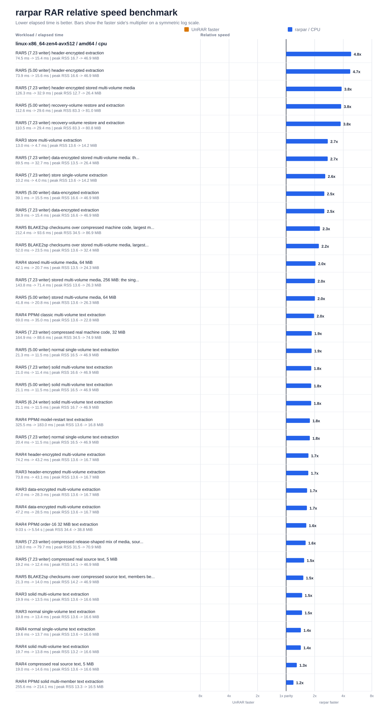](../crates/unrar-rs/docs/rarpar-rar-benchmark-linux-x86_64-zen4-avx512.svg)

[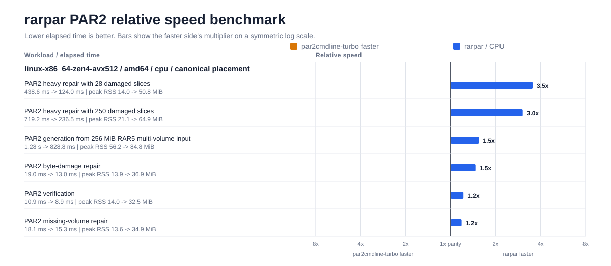](../crates/par2-rs/docs/rarpar-par2-benchmark-linux-x86_64-zen4-avx512.svg)

### Intel Xeon Platinum 8488C (Sapphire Rapids)

4 vCPU · Ubuntu 24.04, Linux 6.17 · dispatch tier GFNI + AVX-512 · candidate
`rarpar 0.8.0`, published static-musl x86-64 build `a9b75dfe…` · references
`UnRAR 7.23` (`926d3a00…`) and `par2cmdline-turbo 1.4.0` (`9e65a4bb…`).

| Store, plain | Store, encrypted | Compressed LZ | Compressed encrypted | Compressed PPMd | PAR2 heavy |
|---:|---:|---:|---:|---:|---:|
| 1.78× | 2.68× | 1.31× | 2.00× | 1.54× | 2.53× |

PAR2 generation is 1.37× here. Both tools ran 13–19% slower in absolute
terms than in the previous fleet run, across every RAR class; the ratios
absorb that, and the movement is host-side.

[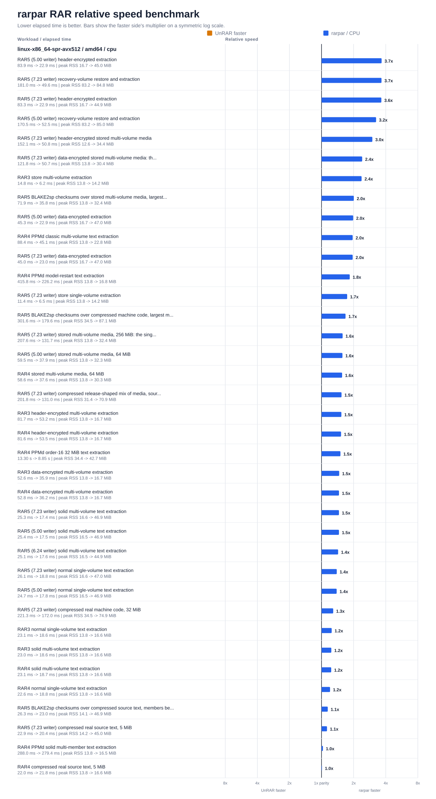](../crates/unrar-rs/docs/rarpar-rar-benchmark-linux-x86_64-spr-avx512.svg)

[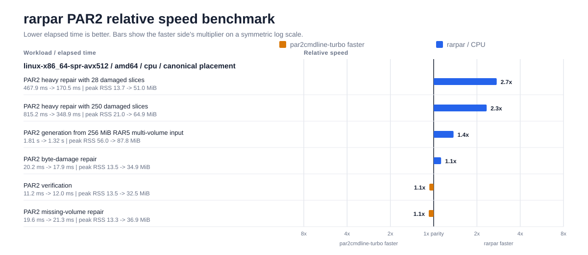](../crates/par2-rs/docs/rarpar-par2-benchmark-linux-x86_64-spr-avx512.svg)

## GFNI + AVX2

GFNI without AVX-512: the same affine-transform multiply, 256 bits wide.

### Intel Core i5-1240P (Alder Lake) †

† Carried from the `rarpar 0.3.3` publication, pending a re-measure.

12 cores / 16 threads · Ubuntu 26.04, Linux 7.0 · dispatch tier GFNI + AVX2 ·
candidate `rarpar 0.3.2`, static-musl x86-64 build `5340a251…` · references
`UnRAR 7.23` (`926d3a00…`) and `par2cmdline-turbo 1.4.0` (`2c3ba0c5…`).

| Store, plain | Store, encrypted | Compressed LZ | Compressed encrypted | Compressed PPMd | PAR2 heavy |
|---:|---:|---:|---:|---:|---:|
| 1.47× | 2.24× | 1.14× | 1.93× | 0.86× | 2.24× |

[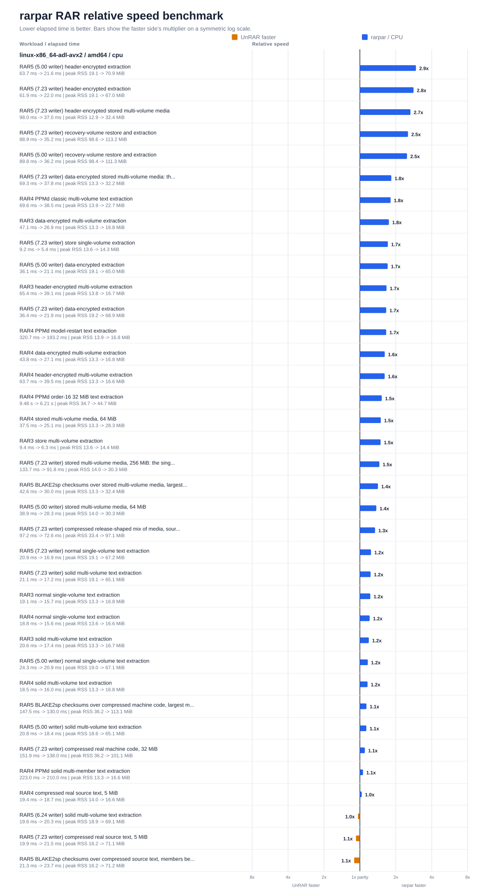](../crates/unrar-rs/docs/rarpar-rar-benchmark-linux-x86_64.svg)

[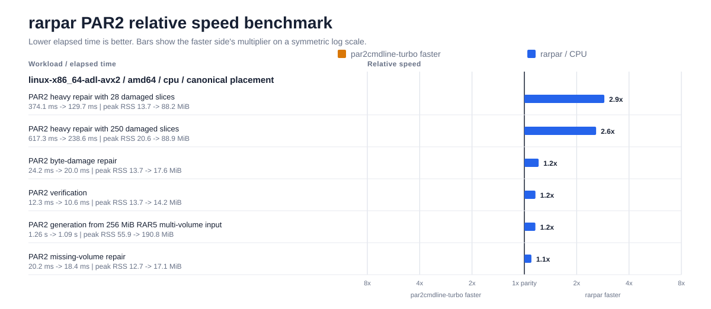](../crates/par2-rs/docs/rarpar-par2-benchmark-linux-x86_64.svg)

## AVX-512

AVX-512 without GFNI: the GF(2¹⁶) multiply uses the folded 512-bit shuffle
kernel rather than `GF2P8AFFINEQB`.

### Intel Xeon Platinum 8124M (Skylake-SP)

4 vCPU · Ubuntu 24.04, Linux 6.17 · dispatch tier AVX-512 · candidate
`rarpar 0.8.0`, published static-musl x86-64 build `a9b75dfe…` · references
`UnRAR 7.23` (`926d3a00…`) and `par2cmdline-turbo 1.4.0` (`9e65a4bb…`).

| Store, plain | Store, encrypted | Compressed LZ | Compressed encrypted | Compressed PPMd | PAR2 heavy |
|---:|---:|---:|---:|---:|---:|
| 1.60× | 1.64× | 1.18× | 1.44× | 1.43× | 2.28× |

This is the only machine in the set that has AVX-512 without GFNI, so it is the
only one that exercises the folded 512-bit shuffle kernel and the non-GFNI
AVX-512 multiply paths. PAR2 generation moved 0.93× → 1.49× here.

[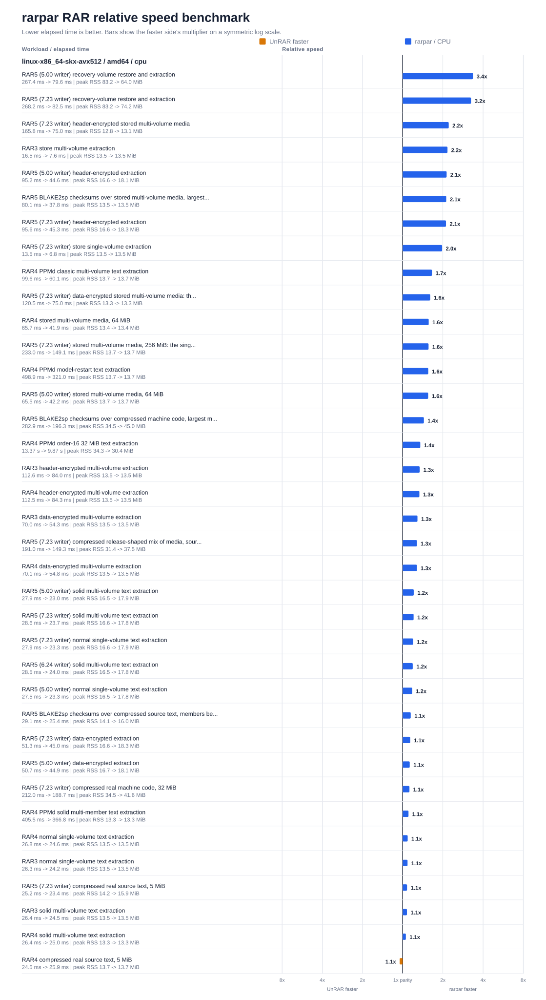](../crates/unrar-rs/docs/rarpar-rar-benchmark-linux-x86_64-skx-avx512.svg)

[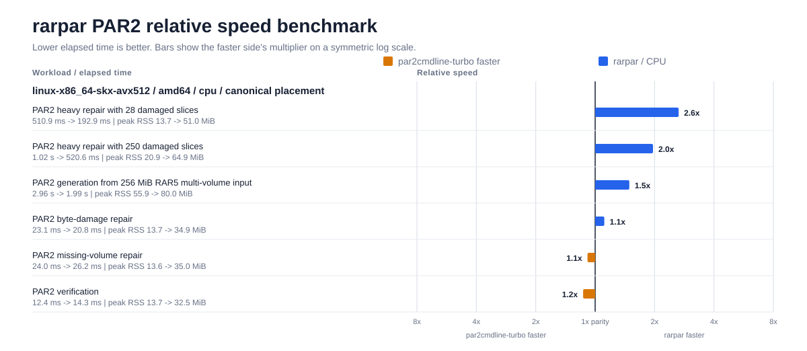](../crates/par2-rs/docs/rarpar-par2-benchmark-linux-x86_64-skx-avx512.svg)

## AVX2

No GFNI: the multiply falls back to the split-table `VPSHUFB` kernel.

### Intel Xeon E5-2666 v3 (Haswell)

4 vCPU · Ubuntu 24.04, Linux 6.17 · dispatch tier AVX2 · candidate
`rarpar 0.8.0`, published static-musl x86-64 build `a9b75dfe…` · references
`UnRAR 7.23` (`926d3a00…`) and `par2cmdline-turbo 1.4.0` (`9e65a4bb…`).

| Store, plain | Store, encrypted | Compressed LZ | Compressed encrypted | Compressed PPMd | PAR2 heavy |
|---:|---:|---:|---:|---:|---:|
| 1.57× | 1.60× | 1.19× | 1.45× | 1.48× | 2.29× |

PAR2 generation is 2.21× here, up from 1.04× — the strongest generation
figure on the board.

[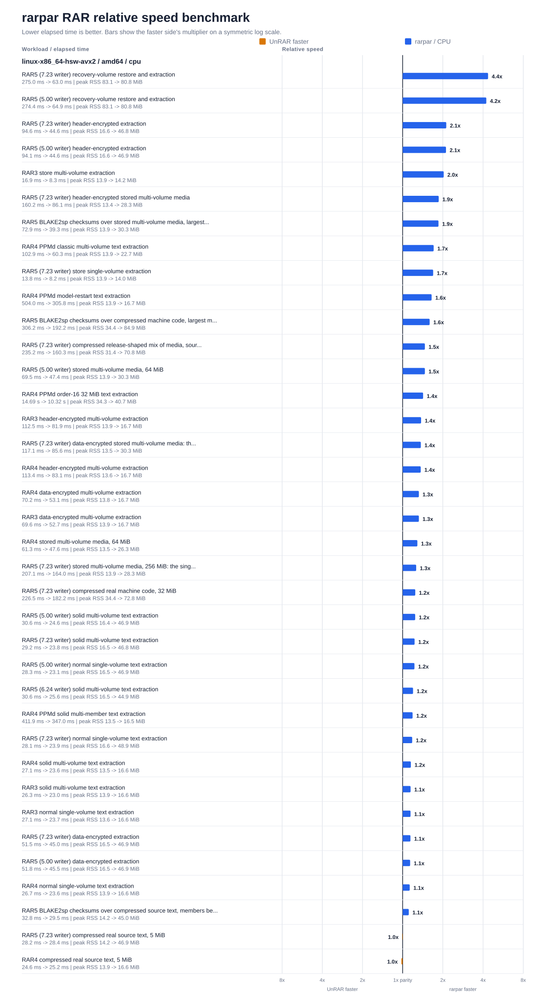](../crates/unrar-rs/docs/rarpar-rar-benchmark-linux-x86_64-hsw-avx2.svg)

[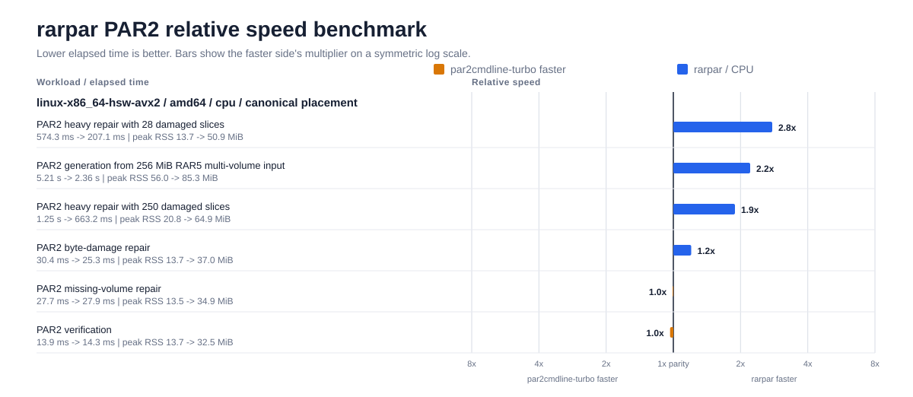](../crates/par2-rs/docs/rarpar-par2-benchmark-linux-x86_64-hsw-avx2.svg)

### AMD Ryzen 5 3600 (Zen 2) †

† Carried from the `rarpar 0.3.3` publication, pending a re-measure.

6 cores / 12 threads · Windows 11 (10.0.22621) · dispatch tier AVX2 · candidate
`rarpar 0.3.2`, native MSVC build `96502790…` · references `UnRAR 7.23 x64`
(`0d371500…`) and `par2cmdline-turbo 1.4.0` (`43779727…`).

| Store, plain | Store, encrypted | Compressed LZ | Compressed encrypted | Compressed PPMd | PAR2 heavy |
|---:|---:|---:|---:|---:|---:|
| 1.43× | 2.09× | 1.46× | 2.22× | 0.90× | 1.56× |

This is the only Windows machine in the set. PAR2 generation is the shape that
moved most here, 0.63× → 0.92×, though it remains below parity; see the note on
the settled-state pass above. Its PPMd class gained the most of any machine
(+7.7%), and one PPMd case — solid multi-member — is now ahead of the reference
decoder at 1.02×.

[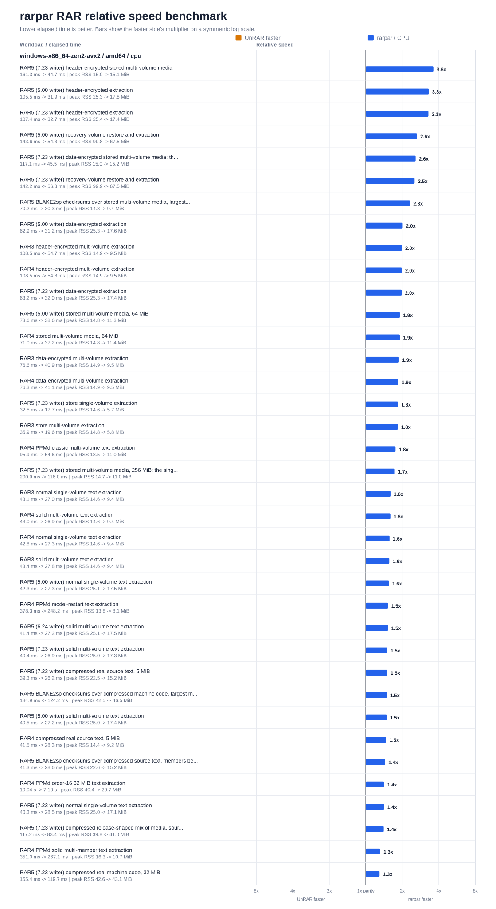](../crates/unrar-rs/docs/rarpar-rar-benchmark-windows-x86_64.svg)

[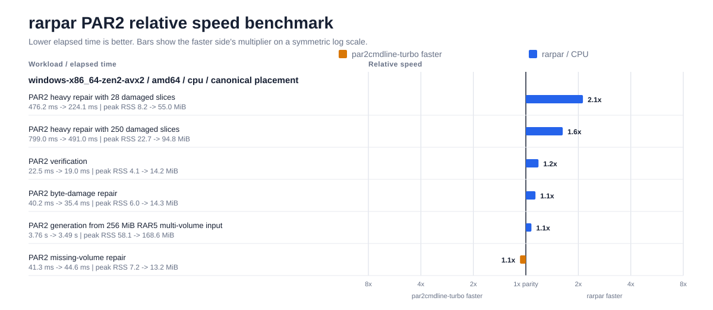](../crates/par2-rs/docs/rarpar-par2-benchmark-windows-x86_64.svg)

## SSSE3 (no AVX)

### Intel Atom C3538 (Denverton) †

† Carried from the `rarpar 0.3.3` publication, pending a re-measure.

4 cores · Linux 4.4 · dispatch tier SSSE3 · candidate `rarpar 0.3.2`,
static-musl x86-64 build `947787d4…` · references `UnRAR 7.23` (`926d3a00…`)
and `par2cmdline-turbo 1.4.0` (`2c3ba0c5…`).

| Store, plain | Store, encrypted | Compressed LZ | Compressed encrypted | Compressed PPMd | PAR2 heavy |
|---:|---:|---:|---:|---:|---:|
| 0.98× | 2.02× | 1.03× | 2.81× | 0.75× | 1.40× |

This is the slowest machine in the set and the only one with no AVX at all. It
moved least: PPMd +5.1% and PAR2 generation +5.4% (0.71× → 0.74×, still the
lowest generation figure on the board), everything else inside 2%.

Plain store-mode sits just under parity on this tier and plain compressed
extraction just over it — the one rung where `rarpar`'s wider kernels have
nothing to work with. The
encrypted classes still win by a wide margin, because AES runs through AWS-LC
against the reference's own AES path.

[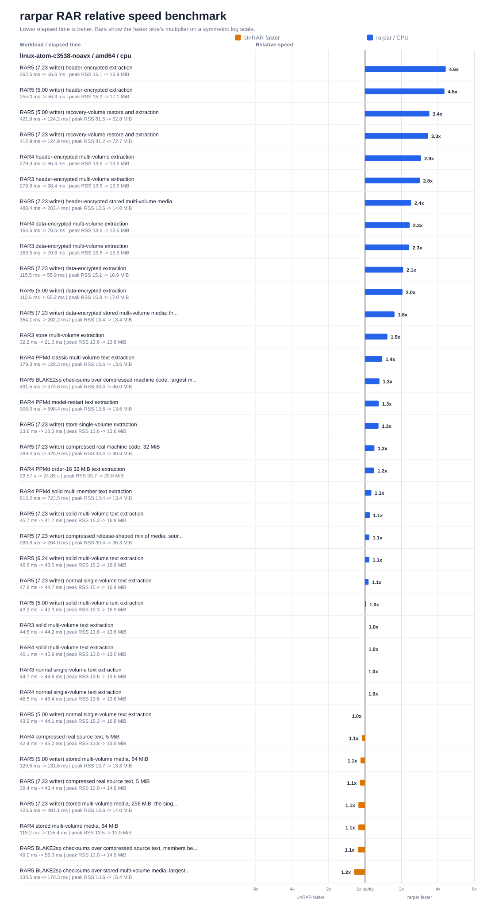](../crates/unrar-rs/docs/rarpar-rar-benchmark-linux-x86_64-noavx.svg)

[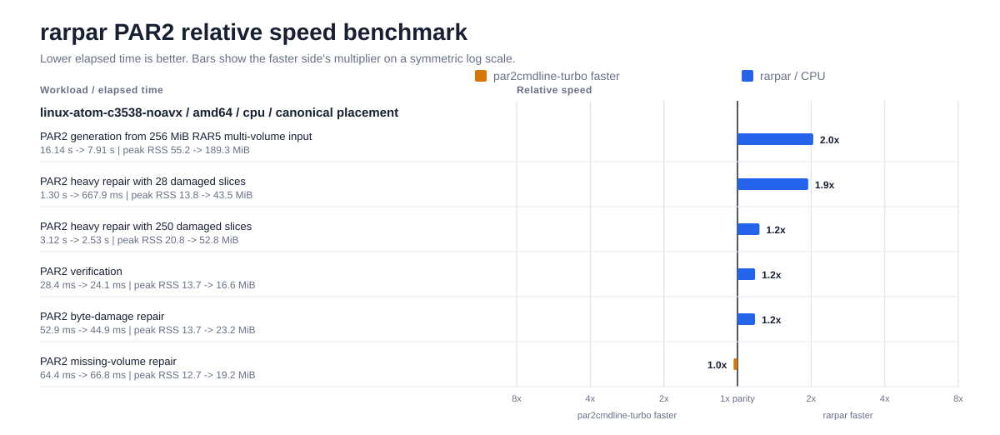](../crates/par2-rs/docs/rarpar-par2-benchmark-linux-x86_64-noavx.svg)

---

# arm64

AArch64 builds use the NEON kernel family; the PMULL carry-less multiply path
and the EOR3 three-way XOR are picked up at runtime where the CPU exposes them.
There is no separate SVE tier.

## Apple M5 Max (macOS) †

† Carried from the `rarpar 0.3.3` publication, pending a re-measure.

18 cores · macOS, Darwin 25.5 · dispatch tier NEON · candidates `rarpar 0.3.2`,
native arm64 builds `c61753a1…` (CPU lane) and `7b9f6d68…` (Metal lane) ·
references `UnRAR 7.23` (`99720d63…`) and `par2cmdline-turbo 1.4.0`
(`32ab46c2…`).

| Store, plain | Store, encrypted | Compressed LZ | Compressed encrypted | Compressed PPMd | PAR2 heavy (CPU) | PAR2 heavy (Metal) |
|---:|---:|---:|---:|---:|---:|---:|
| 1.07× | 2.51× | 1.21× | 2.38× | 1.07× | 7.78× | 5.58× |

PPMd crossed parity here, 0.98× → 1.07× — the largest PPMd gain of any machine
in the set. PAR2 generation went 13.6× → 23.9×, against the slow macOS
reference binary the caveat above describes.

[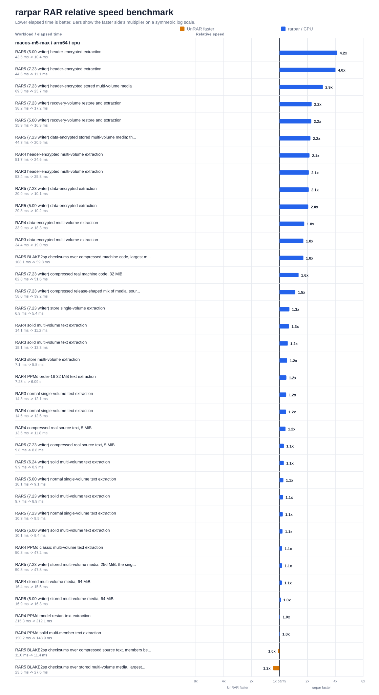](../crates/unrar-rs/docs/rarpar-rar-benchmark-macos-arm64.svg)

[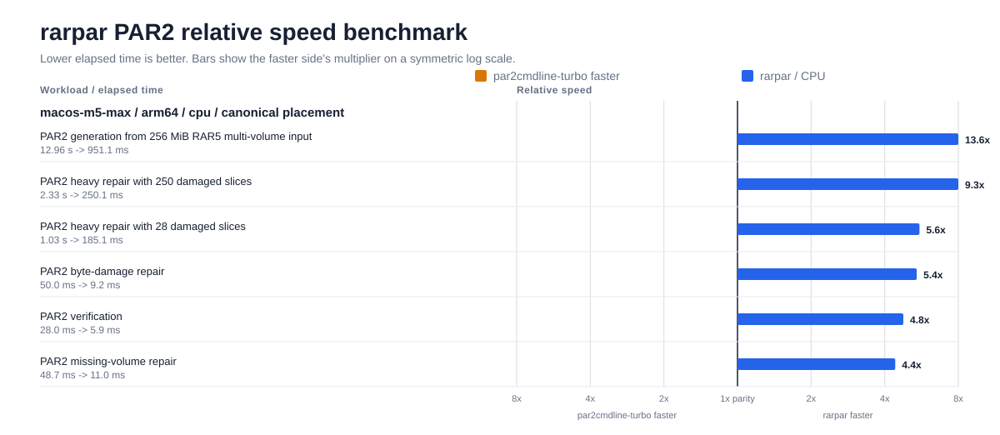](../crates/par2-rs/docs/rarpar-par2-benchmark-macos-arm64-cpu.svg)

The PAR2 column is the one to read with the macOS caveat above in mind: the
macOS reference binary is slow, and it lifts all six PAR2 cases here.

### Metal lane

Shipped `rarpar` binaries are CPU-only. The chart below measures the PAR2
library's optional `metal` feature under normal runtime gating — no force
override. Only the two heavy-repair cases qualified and ran on the GPU;
verification, byte-damage, missing-volume, and generation stayed on CPU in
this lane too.

[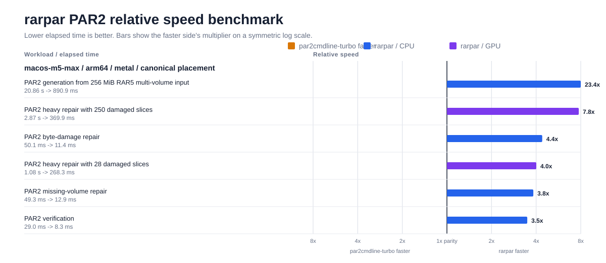](../crates/par2-rs/docs/rarpar-par2-benchmark-macos-arm64-metal.svg)

On this corpus Metal is still slightly *slower* in wall time than the NEON path
(`par2-heavy-damage-250`: 370 ms on Metal against 281 ms on CPU). The GPU
lane's value here is freed CPU, not lower latency; these repairs are small
enough that the NEON kernels already saturate the useful parallelism. Read the
two millisecond figures against each other rather than against the previous
publication's: these were measured under ordinary desktop load, which lifts
both. The Metal lane in particular shared the GPU with other work, and unlike
the CPU lanes that penalty falls on `rarpar` alone — the reference tool is
CPU-only — so the Metal figure here is a floor rather than a best estimate.

## Arm Cortex-A72

4 vCPU · Ubuntu 24.04, Linux 6.17 · dispatch tier NEON · candidate
`rarpar 0.8.0`, published static-musl arm64 build `caa35dbb…` · references
`UnRAR 7.23` (on-host source build, `e36a687a…`) and
`par2cmdline-turbo 1.4.0` (`df2884ca…`).

| Store, plain | Store, encrypted | Compressed LZ | Compressed encrypted | Compressed PPMd | PAR2 heavy |
|---:|---:|---:|---:|---:|---:|
| 1.38× | 6.20× | 1.28× | 2.73× | 1.17× | 1.32× |

Plain store-mode fell 1.74× → 1.38×. Most of that is the reference: the
dynamically linked UnRAR build is about 17% faster on plain store-mode than the
static build it replaced, while `rarpar`'s own plain store-mode time rose 4%.
PAR2 generation is 1.71×.

[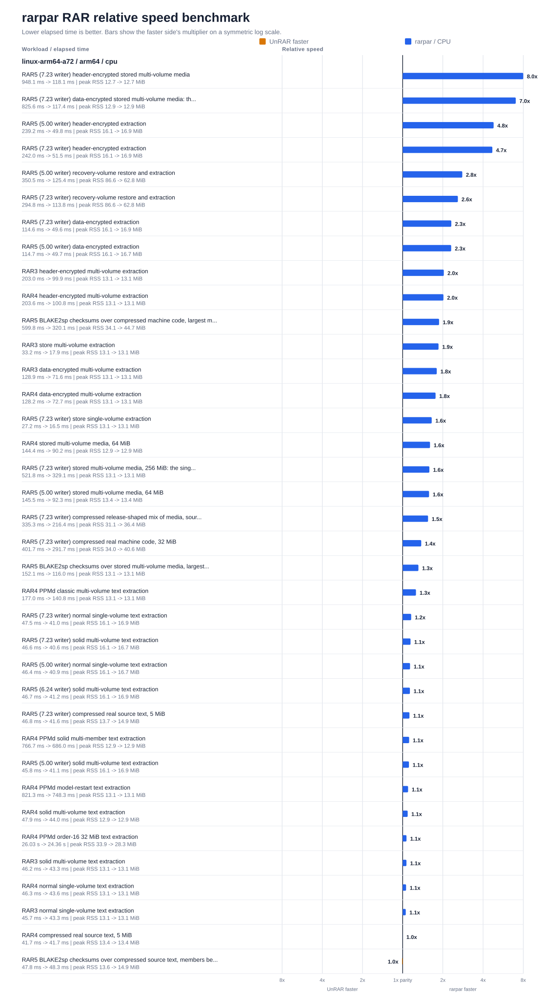](../crates/unrar-rs/docs/rarpar-rar-benchmark-linux-arm64-a72.svg)

[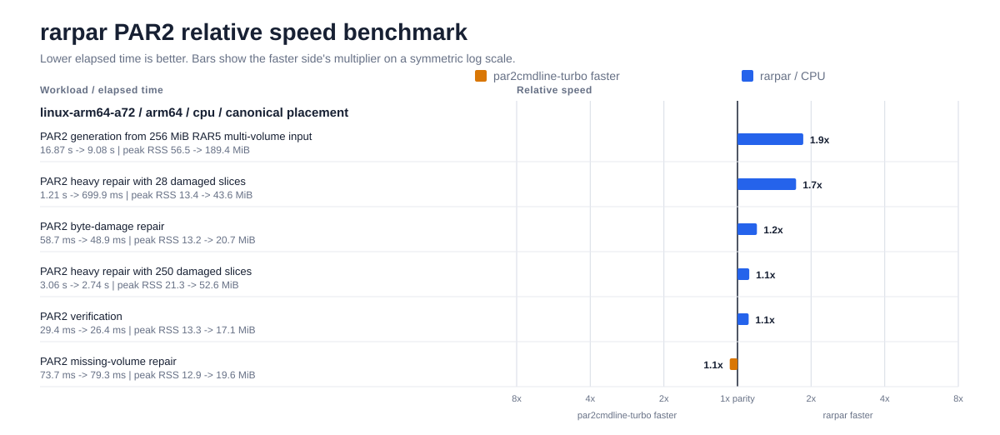](../crates/par2-rs/docs/rarpar-par2-benchmark-linux-arm64-a72.svg)

## Arm Neoverse N1

4 vCPU · Ubuntu 24.04, Linux 6.17 · dispatch tier NEON · candidate
`rarpar 0.8.0`, published static-musl arm64 build `caa35dbb…` · references
`UnRAR 7.23` (on-host source build, `e36a687a…`) and
`par2cmdline-turbo 1.4.0` (`df2884ca…`).

| Store, plain | Store, encrypted | Compressed LZ | Compressed encrypted | Compressed PPMd | PAR2 heavy |
|---:|---:|---:|---:|---:|---:|
| 2.01× | 8.60× | 1.40× | 2.91× | 1.40× | 1.84× |

PAR2 generation is 2.04× here. The candidate's own store-mode medians rose
9% in both store classes against the previous fleet run.

[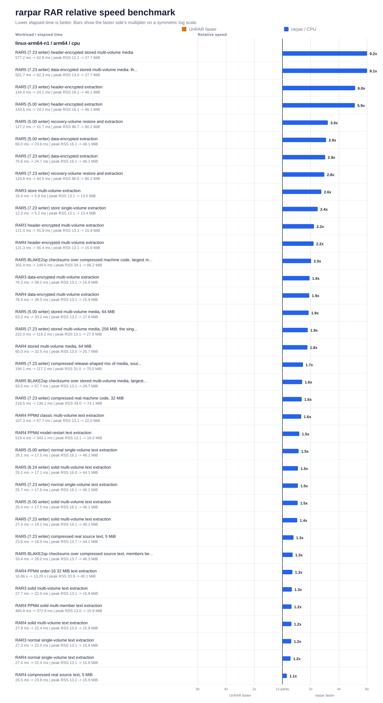](../crates/unrar-rs/docs/rarpar-rar-benchmark-linux-arm64-n1.svg)

[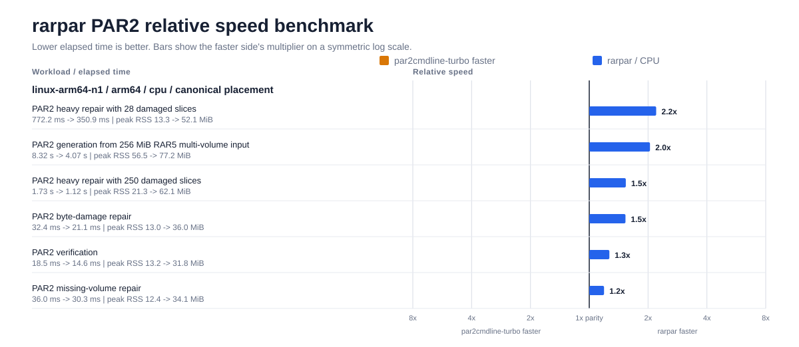](../crates/par2-rs/docs/rarpar-par2-benchmark-linux-arm64-n1.svg)

## Arm Neoverse V2

4 vCPU · Ubuntu 24.04, Linux 6.17 · dispatch tier NEON · candidate
`rarpar 0.8.0`, published static-musl arm64 build `caa35dbb…` · references
`UnRAR 7.23` (on-host source build, `e36a687a…`) and
`par2cmdline-turbo 1.4.0` (`df2884ca…`).

| Store, plain | Store, encrypted | Compressed LZ | Compressed encrypted | Compressed PPMd | PAR2 heavy |
|---:|---:|---:|---:|---:|---:|
| 2.06× | 10.92× | 1.47× | 2.92× | 1.49× | 1.97× |

The widest encrypted store-mode figure on the board, though below the previous
publication's 12.50×: the candidate's own store-mode medians rose 17% (plain)
and 15% (encrypted) against the previous fleet run, with the reference flat or
faster. PAR2 generation is 2.22×.

[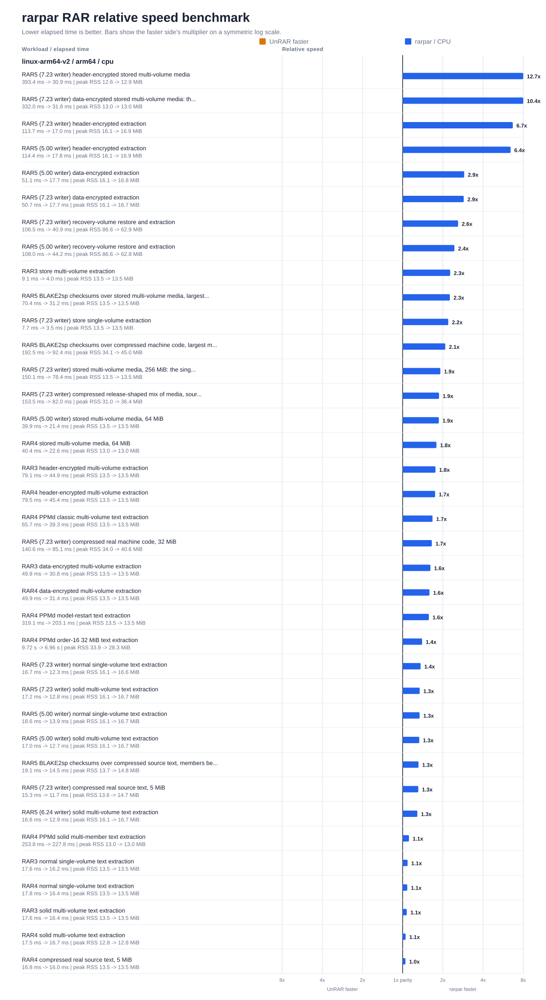](../crates/unrar-rs/docs/rarpar-rar-benchmark-linux-arm64-v2.svg)

[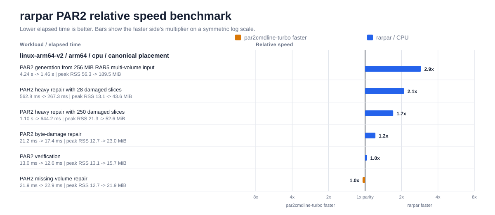](../crates/par2-rs/docs/rarpar-par2-benchmark-linux-arm64-v2.svg)

---

# PAR3

`rarpar par3` against `par3cmdline 0.0.1`, the reference implementation, on
generated data. This runs on the seven cloud machines that were re-measured in
this round (4 vCPU each), under its own harness (`rarpar-bench par3`), with the
same published `rarpar 0.8.0` binaries as the RAR and PAR2 rows. `par3cmdline`
publishes no Linux binary, so each machine builds it from the pinned source;
the reference digests are in the [Versions tested](#versions-tested-in-this-publication) table.

**Sets.** Six plain sets cover both codecs at three sizes, and a seventh
protects a ZIP in place:

| Set | Data | Blocks | Codec | Damage repaired |
|---|---|---|---|---|
| `b-gf16` | 10 × 30 MiB | 300 input + 30 recovery, 1 MiB | Cauchy | 10 blocks across 5 files |
| `b-fft` | 10 × 30 MiB | 300 + 30, 1 MiB | FFT (reference `-e8`) | 10 blocks across 5 files |
| `m-gf16` | 4 × 128 MiB | 512 + 52, 1 MiB | Cauchy | 24 blocks across 4 files |
| `m-fft` | 4 × 128 MiB | 512 + 52, 1 MiB | FFT | 24 blocks across 4 files |
| `a-gf16` | 1 GiB | 1024 + 103, 1 MiB | Cauchy | 50 blocks |
| `c-fft` | 1.5 GiB | 49152 + 4916, 32 KiB | FFT | 2000 blocks |
| ZIP-inside | 4 × 64 MiB stored in one ZIP | 1025 + 103, 256 KiB, chosen by the reference's insert | Cauchy | 40 blocks inside the ZIP |

`c-fft` is over PAR2's 32768-block limit, so it has no PAR2 equivalent, and the
reference's Cauchy codec is quadratic at that size. The ZIP-inside set is
protected once by the reference's insert, untimed; both tools then verify it
and repair it in place.

**Protocol.** One warmup and seven measured runs per row (three on `a-gf16`
and `c-fft`, to keep the slowest machine inside its session cap), with the
order alternated each repeat. The reference is single-threaded; `rarpar` runs
with 1 and with 4 workers. Every ratio is `reference median wall time / rarpar
median wall time`, as on the rest of this page. `rarpar` writes buffered and
never passes `--fsync`; the reference never syncs either.

**Repair, like for like.** `par3cmdline` keeps a numbered `.1` backup of every
file it repairs, which copies the whole file. `rarpar par3 repair` repairs in
place by default and keeps no backup; with `--backup` it keeps the same `.1`
backups. The **Repair** columns below compare the `--backup` runs,
which write the same bytes as the reference. The **Repair in place** column is
`rarpar`'s default, and most of the gap between the two columns is the cost of
copying the backups.

**Output.** On every set and machine, every recovery block's payload that
`rarpar` wrote is byte-identical to the reference's, under the same InputSetID.
The sets differ only in packet metadata: the Creator packet names the tool,
and the packets are laid out differently across the volumes. Every repair is checked byte for
byte against the generated inputs.

## PAR3 summary

Geometric mean over the six plain sets per operation, plus the ZIP-inside set.
Above 1 means `rarpar` is faster.

| CPU | Create, 1 worker | Create, 4 workers | Verify, 1 worker | Verify, 4 workers | Repair, 1 worker | Repair, 4 workers | Repair in place, 4 workers | ZIP-inside verify | ZIP-inside repair |
|---|---:|---:|---:|---:|---:|---:|---:|---:|---:|
| AMD EPYC 9R14 (Zen 4) | 5.76× | 10.71× | 4.00× | 7.83× | 1.95× | 1.62× | 18.04× | 4.11× | 2.61× |
| Intel Xeon Platinum 8488C (Sapphire Rapids) | 4.88× | 7.30× | 3.50× | 5.40× | 2.42× | 2.17× | 12.41× | 3.53× | 2.69× |
| Intel Xeon Platinum 8124M (Skylake-SP) | 4.48× | 7.65× | 3.63× | 5.57× | 2.43× | 2.63× | 12.37× | 3.77× | 2.95× |
| Intel Xeon E5-2666 v3 (Haswell) | 3.49× | 5.95× | 3.33× | 5.57× | 1.78× | 1.90× | 11.19× | 3.94× | 2.14× |
| Arm Cortex-A72 | 2.17× | 5.20× | 3.38× | 8.14× | 2.52× | 4.32× | 7.05× | 4.30× | 3.06× |
| Arm Neoverse N1 | 2.44× | 7.13× | 3.80× | 9.21× | 2.42× | 3.50× | 9.24× | 3.87× | 3.30× |
| Arm Neoverse V2 | 3.26× | 8.93× | 4.22× | 11.12× | 2.07× | 2.08× | 11.65× | 6.37× | 2.74× |

`rarpar` is ahead on every operation and every machine as a class. Single-worker
rows are the like-for-like engine comparison against the single-threaded
reference. The ZIP-inside rows go through `rarpar`'s `par3cmdline`-compatible
front end (`vs`/`rs`), which syncs the rebuilt carrier and keeps a `.1` of it,
as the reference does.

The one result below parity is repair with backups on `m-fft`: 0.92× on Zen 4
and Haswell (0.94× and 0.95× with 1 worker). The same repair in place runs
18.10× and 11.68× there, so the loss is in copying the backups (512 MiB on
this set), not in the codec.

## PAR3 per set, 4 workers

**Create, 4 workers**

| Set | Zen 4 | Sapphire Rapids | Skylake-SP | Haswell | Cortex-A72 | Neoverse N1 | Neoverse V2 |
|---|---:|---:|---:|---:|---:|---:|---:|
| `b-gf16` | 16.66× | 11.40× | 12.76× | 8.71× | 6.70× | 10.46× | 12.58× |
| `b-fft` | 5.43× | 3.81× | 4.10× | 3.82× | 4.26× | 4.93× | 5.84× |
| `m-gf16` | 23.57× | 15.02× | 16.05× | 10.32× | 5.96× | 11.35× | 14.66× |
| `m-fft` | 5.79× | 4.15× | 4.42× | 4.14× | 4.52× | 5.37× | 6.11× |
| `a-gf16` | 33.51× | 18.64× | 18.64× | 11.54× | 7.68× | 11.07× | 16.86× |
| `c-fft` | 3.64× | 3.00× | 2.89× | 2.72× | 3.35× | 3.79× | 4.55× |

**Verify, 4 workers**

| Set | Zen 4 | Sapphire Rapids | Skylake-SP | Haswell | Cortex-A72 | Neoverse N1 | Neoverse V2 |
|---|---:|---:|---:|---:|---:|---:|---:|
| `b-gf16` | 10.37× | 6.72× | 7.21× | 7.03× | 8.48× | 10.33× | 11.55× |
| `b-fft` | 10.34× | 7.23× | 7.24× | 6.20× | 8.50× | 10.33× | 11.57× |
| `m-gf16` | 10.87× | 6.76× | 6.84× | 7.00× | 9.33× | 11.51× | 12.87× |
| `m-fft` | 10.79× | 6.91× | 6.85× | 6.99× | 9.34× | 11.50× | 12.87× |
| `a-gf16` | 4.92× | 3.88× | 4.04× | 4.31× | 7.78× | 7.48× | 10.92× |
| `c-fft` | 3.71× | 2.81× | 3.02× | 3.24× | 5.96× | 5.80× | 7.82× |

**Repair with backups, 4 workers**

| Set | Zen 4 | Sapphire Rapids | Skylake-SP | Haswell | Cortex-A72 | Neoverse N1 | Neoverse V2 |
|---|---:|---:|---:|---:|---:|---:|---:|
| `b-gf16` | 2.74× | 3.70× | 7.23× | 3.49× | 5.51× | 7.40× | 4.08× |
| `b-fft` | 2.86× | 3.69× | 5.44× | 3.20× | 5.66× | 5.60× | 3.49× |
| `m-gf16` | 1.25× | 1.49× | 1.76× | 1.31× | 4.58× | 3.18× | 1.69× |
| `m-fft` | 0.92× | 1.17× | 1.27× | 0.92× | 2.78× | 1.65× | 1.16× |
| `a-gf16` | 1.68× | 1.97× | 2.45× | 1.80× | 5.10× | 4.53× | 2.15× |
| `c-fft` | 1.18× | 2.25× | 1.52× | 1.93× | 3.23× | 1.87× | 1.36× |

**Repair in place, 4 workers**

| Set | Zen 4 | Sapphire Rapids | Skylake-SP | Haswell | Cortex-A72 | Neoverse N1 | Neoverse V2 |
|---|---:|---:|---:|---:|---:|---:|---:|
| `b-gf16` | 17.11× | 11.94× | 13.42× | 10.59× | 6.46× | 9.57× | 12.01× |
| `b-fft` | 14.26× | 9.41× | 9.94× | 9.35× | 6.56× | 8.18× | 9.25× |
| `m-gf16` | 25.42× | 14.26× | 16.58× | 11.66× | 8.13× | 11.41× | 14.87× |
| `m-fft` | 18.10× | 11.15× | 11.84× | 11.68× | 7.86× | 9.86× | 11.55× |
| `a-gf16` | 24.98× | 14.74× | 16.70× | 11.49× | 8.18× | 10.87× | 15.59× |
| `c-fft` | 12.28× | 13.85× | 8.20× | 12.66× | 5.55× | 6.51× | 8.40× |

## PAR3 peak memory

Peak resident set in MiB, 4 workers, as the range across the seven machines
(`a-gf16` excludes Neoverse V2; see below). Create and repair are shown;
verify peaks are not resolved in this run (see the note under the table).

| Set | Create, rarpar | Create, reference | Repair, rarpar | Repair, reference |
|---|---:|---:|---:|---:|
| `b-gf16` | 54–58 | ≤ 43–46 | 44–47 | ≤ 43–46 |
| `b-fft` | 54–55 | 376–377 | ≤ 43–46 | 827–828 |
| `m-gf16` | 78–82 | ≤ 65–67 | 72–78 | ≤ 65–67 |
| `m-fft` | 80–81 | 652–653 | ≤ 65–68 | 1551–1552 |
| `a-gf16` | 134–138 | ≤ 115–118 | 133–138 | ≤ 115–118 |
| `c-fft` | 239–241 | 2072–2073 | 275–282 | 3612–3613 |

On the FFT sets the reference's peak grows with the set and `rarpar`'s stays
small: `c-fft` repair peaks at 3.5 GiB in the reference against 275–282 MiB in
`rarpar`. On the Cauchy sets the reference's peaks sit under the floor
described below, so the two tools cannot be compared there; `rarpar`'s are
44–138 MiB.

A figure marked ≤ is not the tool's own peak. On Linux, a child process's
recorded peak never drops below the measuring harness's own resident set at
the moment it launches the child, and the harness grows as it generates each
set. Those cells read the same value for both tools at that floor (43–46 MiB on
the `b` sets, 65–68 on the `m` sets, 115–118 on `a-gf16`), so the tool's true
peak is that figure or lower. This is why every verify peak and every
reference Cauchy peak is unresolved. On Neoverse V2 the floor on `a-gf16` was
139 MiB, which hides both tools there. The FFT reference peaks and every
`rarpar` create and repair peak sit above the floor and are real measurements.

## PAR2 against PAR3

`rarpar-bench par3 versus` protects and repairs the same generated inputs with
PAR2 and PAR3 at one block size, one recovery count and one damage pattern for
every arm: `rarpar par` (`par2-rs`), `par2cmdline-turbo 1.4.0`, and `rarpar
par3` with the Cauchy and FFT codecs. It ran with the published `rarpar 0.8.1`
binaries on nine machines: the seven cloud machines above (4 vCPU each; the
Skylake-SP slot landed on an Intel Xeon Platinum 8275CL, Cascade Lake, this
round), the Alder Lake laptop (16 threads) and the Zen 2 desktop under Windows
(12 threads). One warmup and seven measured runs per arm; every arm runs at its
default thread count, and every repair is checked against the inputs' SHA-256.

| Comparison | Data | Blocks | Arms |
|---|---|---|---|
| `vs-a-equal` | 1 GiB | 1024 + 103, 1 MiB | all four |
| `vs-b-equal` | 10 × 30 MiB | 300 + 30, 1 MiB | all four |
| `vs-a-fft10` | 1 GiB | 16384 + 1639, 64 KiB | PAR2 arms and `par3-fft` |
| `vs-a-fft30` | 1 GiB | 16384 + 4916, 64 KiB | PAR2 arms and `par3-fft` |

Each chart draws every arm against `par2cmdline-turbo` on the same scale as
the rest of this page: its median wall time divided by the arm's. At repair,
`par2cmdline-turbo` keeps a numbered `.1` of every file it repairs, so the
rows marked **keeps .1** (`rarpar par3 repair --backup`) write the same bytes
it does; rows marked **in place** write no backup, and are like for like with
`par2-rs`, which also repairs in place.

- **Create.** `par3-fft` is ahead on every machine: 2.5–5.3× on set A and
  1.7–3.6× on set B at 1 MiB blocks, 7–31× at 64 KiB blocks and 10% recovery,
  and 18–66× at 30%. `par3-cauchy` ranges from 0.62× (Cortex-A72) to 2.5×
  (Zen 4). At 64 KiB blocks `par2-rs` is itself 2.1–12× ahead of
  `par2cmdline-turbo`.
- **Repair in place.** 1.2–14× ahead of `par2cmdline-turbo` across the
  equal-count rows, and 3.0–24× on the FFT-only rows.
- **Repair keeping `.1`, like for like.** On the seven cloud machines this is
  behind `par2cmdline-turbo` on the equal-count sets, except Cortex-A72's FFT
  row on set A: 0.55–1.16× on set A and 0.23–0.66× on set B. The same sets repaired in place run 1.2–14× ahead there,
  so the loss is in keeping the backups, not in the codec. On Alder Lake it is
  0.74–2.2×, and on Zen 2 under Windows 2.2–3.3×.

[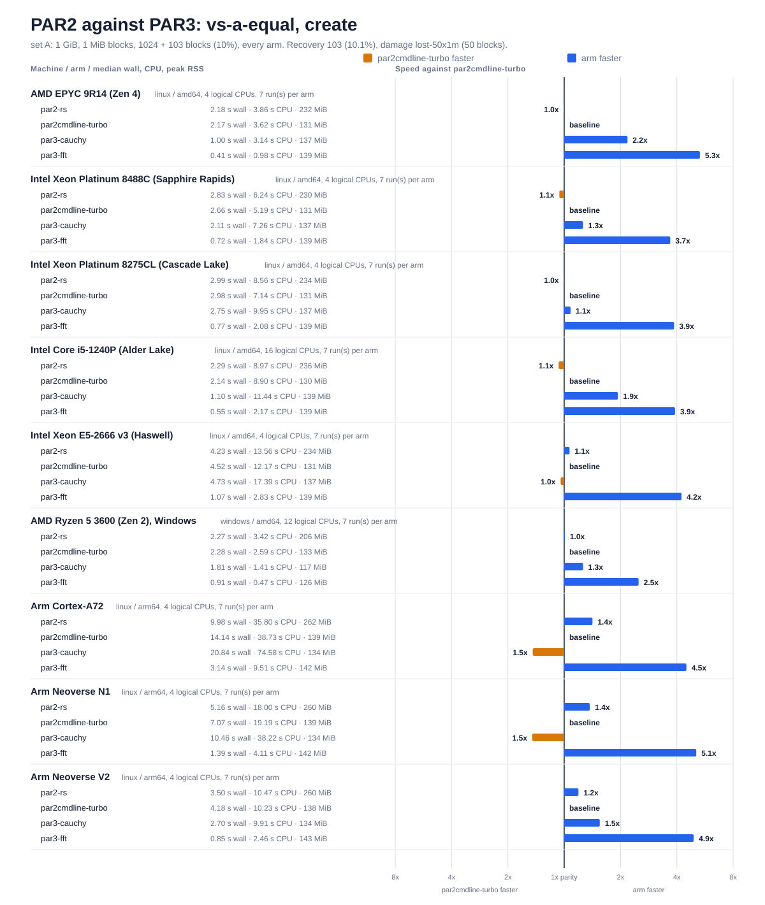](par3-versus/rarpar-par3-versus-vs-a-equal-create.svg)

[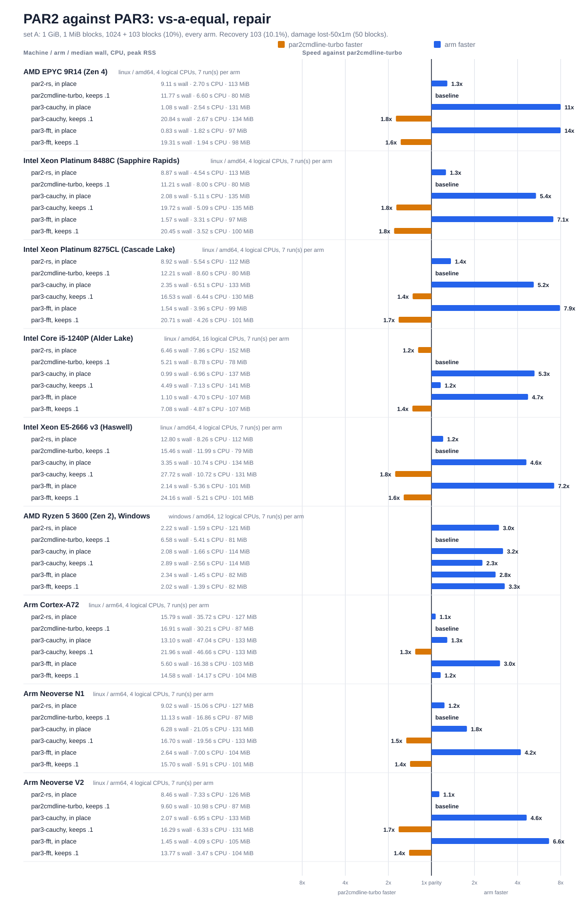](par3-versus/rarpar-par3-versus-vs-a-equal-repair.svg)

[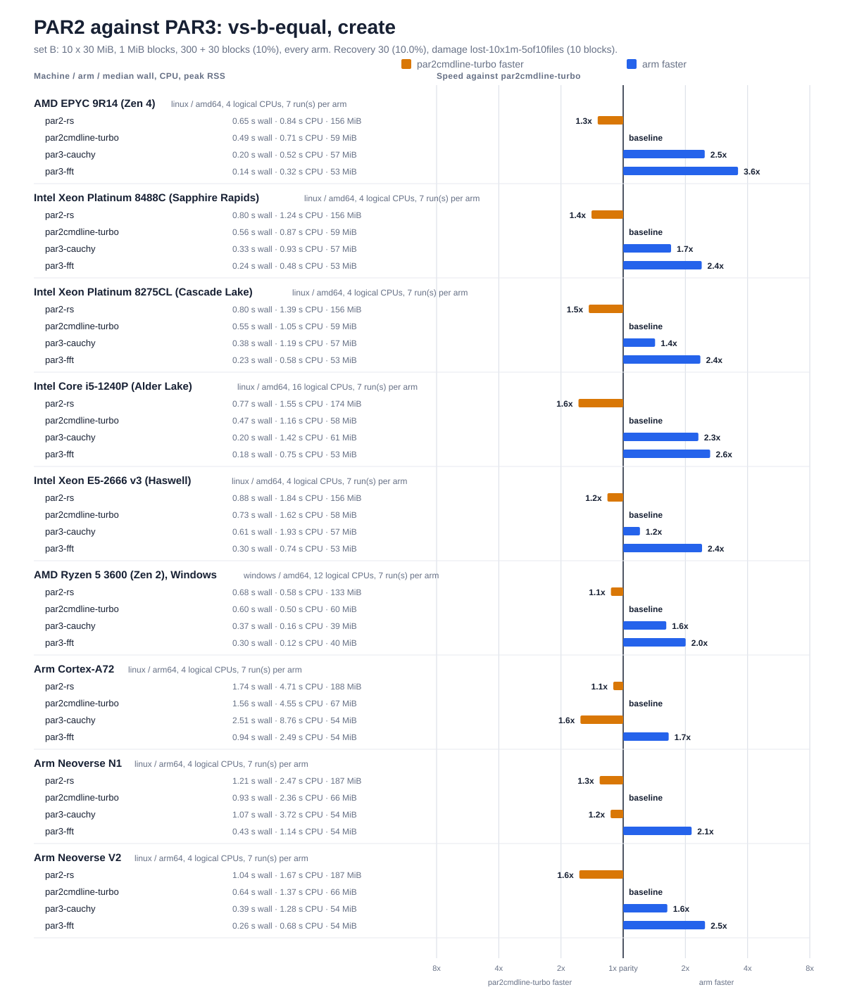](par3-versus/rarpar-par3-versus-vs-b-equal-create.svg)

[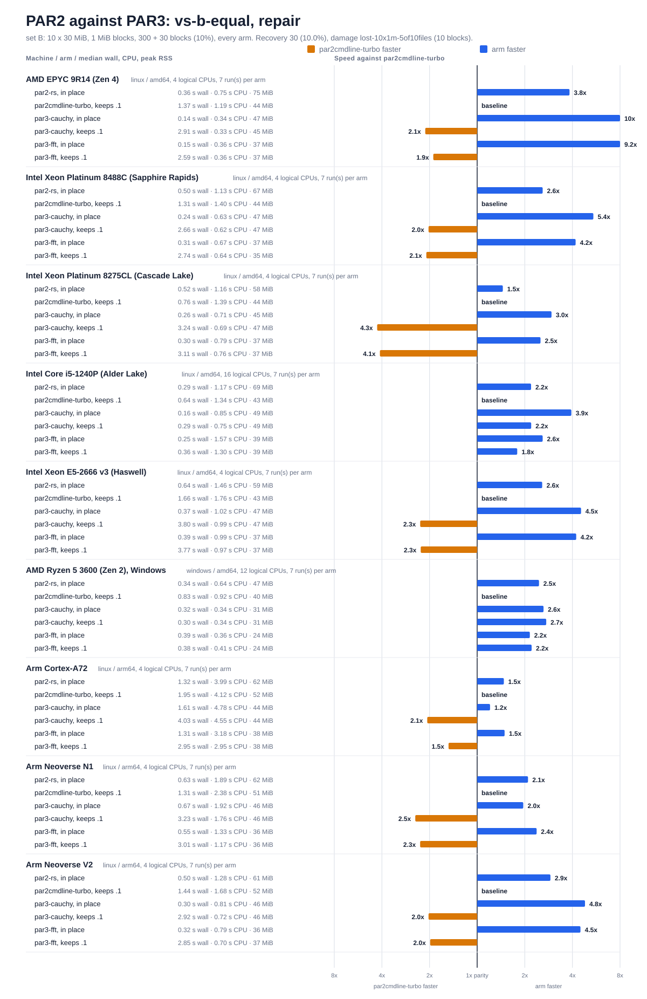](par3-versus/rarpar-par3-versus-vs-b-equal-repair.svg)

[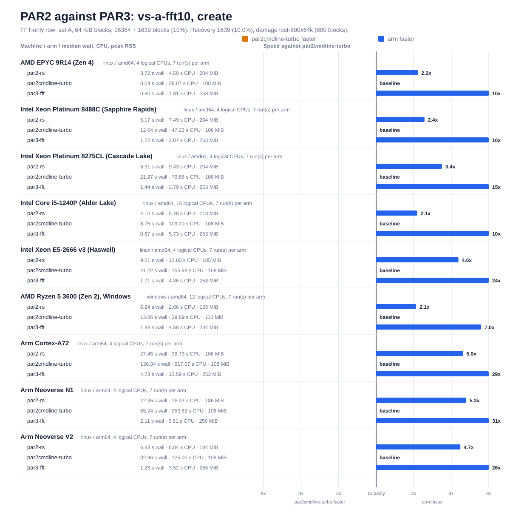](par3-versus/rarpar-par3-versus-vs-a-fft10-create.svg)

[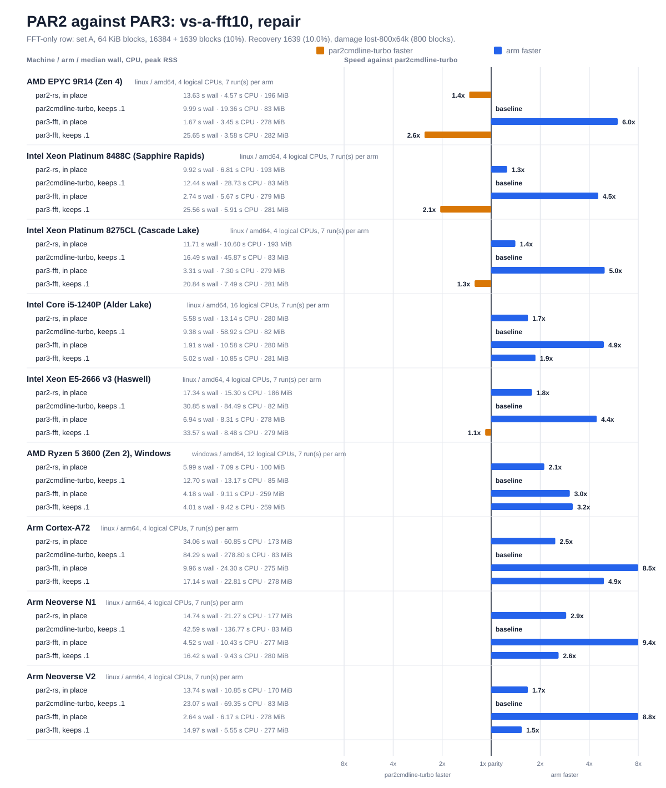](par3-versus/rarpar-par3-versus-vs-a-fft10-repair.svg)

[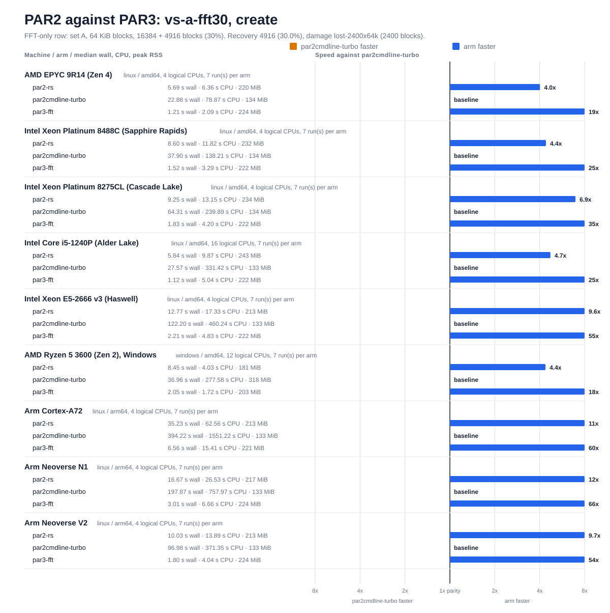](par3-versus/rarpar-par3-versus-vs-a-fft30-create.svg)

[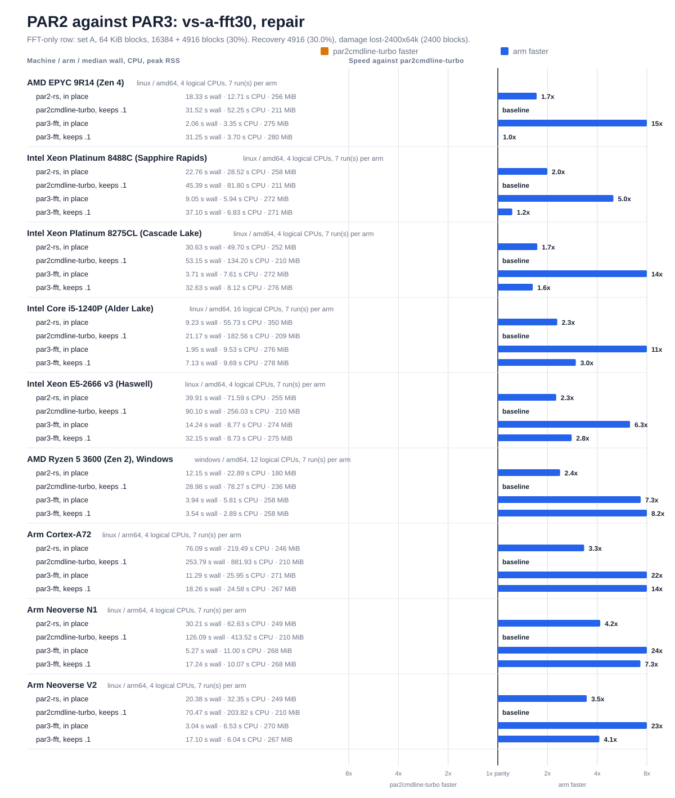](par3-versus/rarpar-par3-versus-vs-a-fft30-repair.svg)
