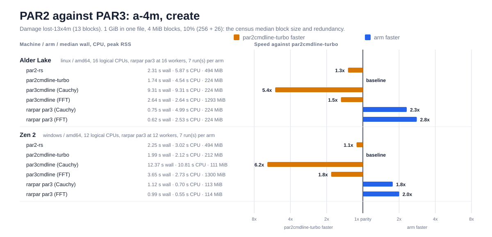
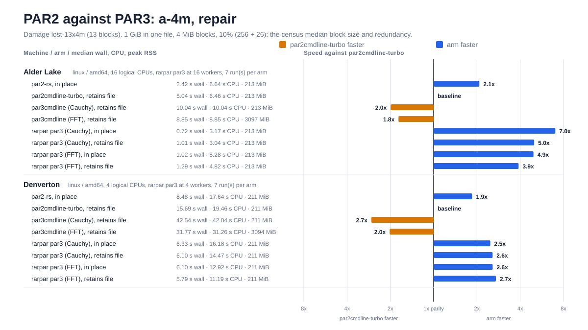
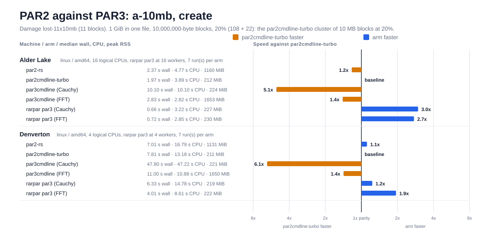
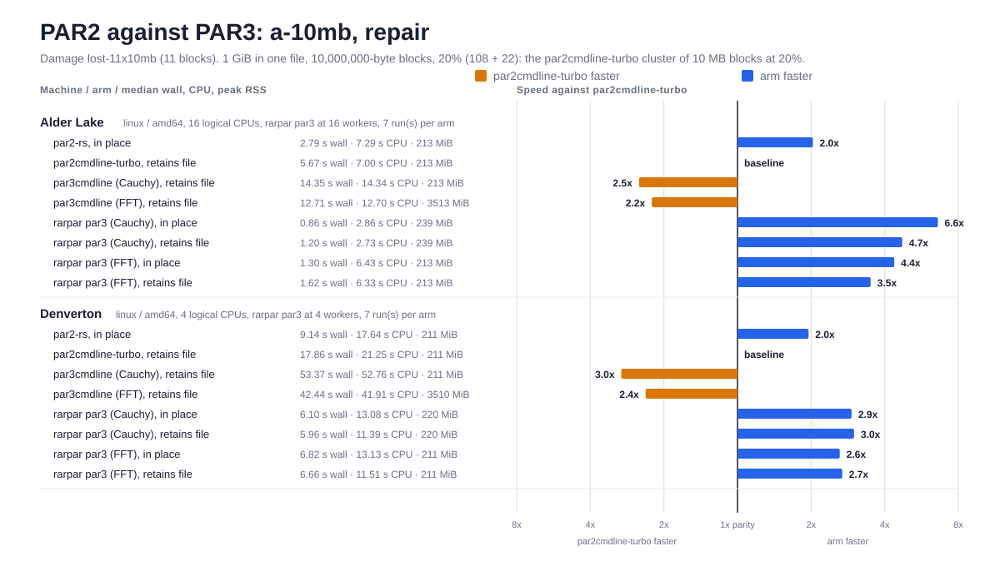
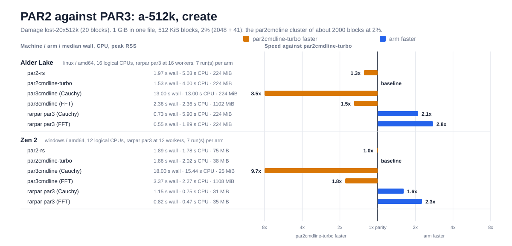
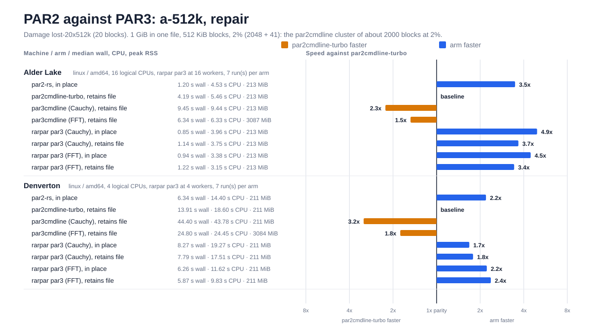
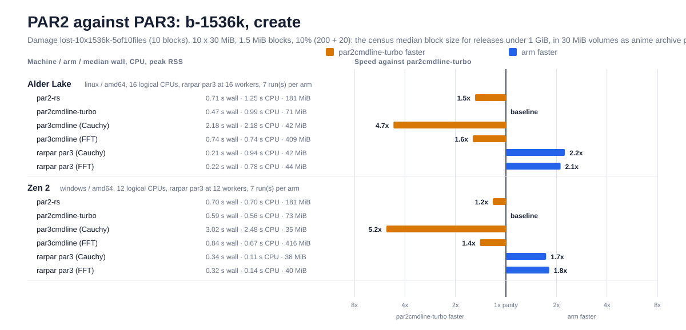
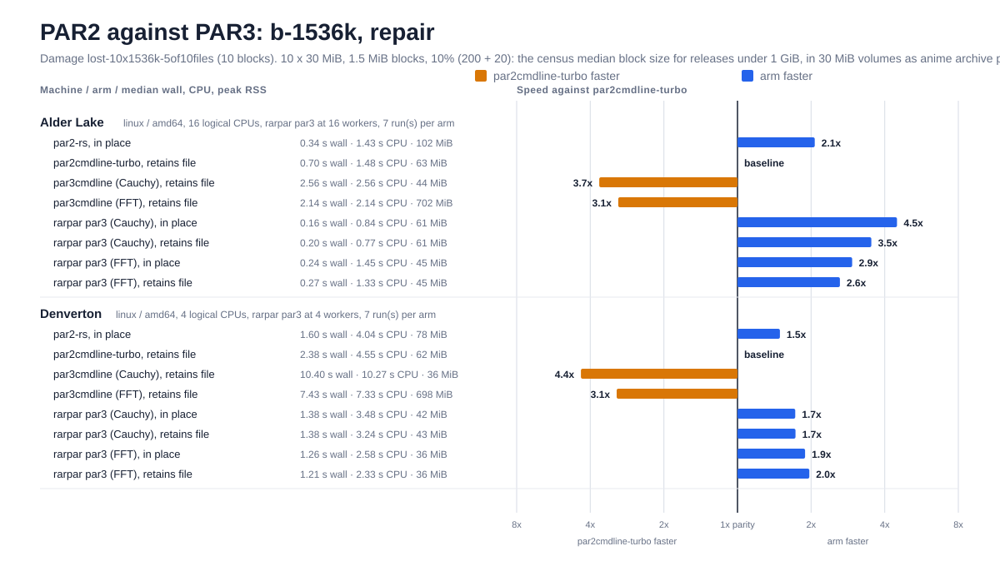

# rarpar benchmarks

This is the full benchmark record behind the summary table in the
[README](../README.md). Every chart on this page comes from one 43-case
`rarpar-bench` corpus, one pair of measurement plans, and the same reference
tools, so charts can be read across machines. PAR3 is measured by a separate
harness against `par3cmdline`; its results are in the [PAR3](#par3) section at
the end.

Charts are grouped by **architecture**, then by **dispatch tier** — the SIMD
kernel family `rarpar` actually selects at runtime on that silicon. Both the
RAR family chart and the PAR2 family chart are shown for every machine. Click
any chart to open it full size.

## Methodology

**What is measured.** Each case is a whole-CLI run: discovery, the operation
itself, integrity checking, and output handling. These are release-workflow
measurements, not isolated decoder or kernel microbenchmarks. Every produced
byte is validated against expected paths, sizes, and SHA-256 values, and
unmatched or failed samples are dropped rather than reported. The figure taken
from each case is the **median wall-clock time** over the measured repeats.

**How ratios are formed.** Every number on this page is
`reference median wall time / rarpar median wall time`. **Above 1 means
`rarpar` is faster**, and `2.0×` means `rarpar` finished in half the time.
The charts plot that ratio per case. The tables aggregate it into a
**geometric mean** over a workload class — geometric rather than arithmetic so
that a 4× win and a 0.25× loss cancel to parity instead of averaging to 2.1×.

**Protocol.** One warmup and seven measured repeats per case, in a
deterministic plan order, with the candidate and the reference alternating
which one runs first so that ordering cannot bias a pair. Each sample runs in
its own byte-copied private staging directory. Runs are gated on a quiet
machine — an idle-CPU sample must clear its threshold before a timed window
opens, and the candidate and the reference for a given case are measured
inside the same window. The corpus is the 43-case real-payload
`rarpar-bench` corpus, digest `59f46fa58f65…`, byte-verified on every machine
before measurement; it contains real media, real source text, and real machine
code alongside the synthetic format-coverage cases. The PAR2 plan uses
`canonical` placement — the comparable lane for conventional PAR2 tools, with
`rarpar`'s content-based relocation scan switched off.

**What was built.** The Linux rows on this page — x86-64 and arm64 alike —
measure the portable **static-musl** artifact: the same binary shipped in the
Linux musl release archives and used to build the container image. The macOS
and Windows rows measure **native** builds for those platforms. A native glibc
Linux build measures a few percent faster than the musl artifact on the same
hardware, so the Linux rows are, if anything, conservative.

**Standing caveats.**

- *macOS PAR2.* The macOS rows are measured against upstream's published
  `macos-arm64` `par2cmdline-turbo` binary — the same reference role as every
  other row, taken from the project's own release. That binary is markedly
  slower on macOS than the Linux and Windows builds of the same version, which
  lifts every macOS PAR2 ratio here, including the 7.8× heavy-repair figure.
  It is an honest comparison against what a macOS user would actually install;
  it is not a claim that the PAR2 engine is five times faster on Apple Silicon
  than on x86-64.
- *arm64 RAR reference.* RARLAB publishes no Linux/arm64 UnRAR binary, so the
  three Linux/arm64 machines run a source build of the same `7.23` release
  (the source archive self-identifies as `7.20 beta 3` — RARLAB's naming for
  the identical build). Same version, same comparison as every other row. The
  build is made on each host with the host's `g++` and links dynamically
  against the host's glibc; the build is byte-identical on all three machines.
  The statically linked build used in earlier publications crashed on start
  on these hosts, and it was also slower: the dynamic build runs plain
  store-mode about 17% faster on Cortex-A72, which lowers that machine's
  plain store-mode ratio without any change in `rarpar`.
- *Windows CPU time.* The Windows machine's CPU-time counter is quantized to
  roughly 15.6 ms, so short cases report zero CPU seconds there. Every figure
  on this page is wall-clock and is unaffected.
- *Shapes that lose.* On the ten machines measured on `rarpar 0.9.x`, RAR4
  PPMd is ahead of the reference decoder as a class on every one
  (1.13×–1.50×), and PAR2 generation is ahead of `par2cmdline-turbo` on every
  one (1.08×–2.90×). What still trails is small. PAR2 missing-volume repair
  runs 0.80×–0.96× on eight of the ten machines. PAR2 verification runs
  0.75×–0.97× on the four Intel and AMD cloud machines; Skylake-SP's 0.75× is
  the lowest case on the board. The dense compressible source-text archives
  sit at 0.82×–0.99× on six machines, lowest on Denverton and Alder Lake, and
  PAR2 byte-damage repair runs 0.95× on Skylake-SP. The
  Apple row carried from an earlier publication (marked † below) still shows
  that run's picture. PAR2 generation is charted per machine but is not part
  of the heavy-repair class.

### Workload classes

| Class | Meaning | Cases |
|---|---|---:|
| **unrar (binary)** | Store-mode extraction — uncompressible payloads (media), including the encrypted and BLAKE2sp variants | 8 |
| **unrar (text)** | Compressed extraction — the LZ and PPMd decode paths, including compressed machine code, mixed release payloads, and the encrypted compressed cases | 27 |
| **par2 (heavy)** | `par2-heavy-damage-28` + `par2-heavy-damage-250` | 2 |

`unrar (text)` **includes PPMd.** PPMd is an archaic RAR4 mode; it is now
ahead of the reference decoder on all ten re-measured machines, and it is
counted in the class either way.

Six of the 43 cases sit outside these three classes. They are charted but not
aggregated: `rar5-v5-recovery-volume` and `rar5-v7-recovery-volume` (recovery
volume reconstruction rather than an extraction shape), and the four non-heavy
PAR2 cases `par2-verify`, `par2-byte-damage`, `par2-missing-volume`, and
`par2-generate-rar5-v7-volumes`.

### Versions tested in this publication

This page always reflects the most recent benchmark run — it is not a running
ledger; historical results live in this file's git history. This block records
exactly what produced the current numbers and is replaced wholesale by each
refresh.

| Component | Version |
|---|---|
| `rarpar` CLI | 0.9.0, tag `rarpar-v0.9.0` (workspace commit `1bc3750`), and 0.9.1, tag `rarpar-v0.9.1` (workspace commit `e954b91`), the published release assets |
| `par2-rs` | 0.10.11 |
| `unrar-rs` | 0.12.0 |
| `par3-rs` | 0.7.1 |
| `reedsolomon-rs` | 0.4.11 |
| Rust toolchain | 1.97.1 |
| Corpus | `rarpar-bench`, 43 cases, digest `59f46fa58f65…` |
| RAR plan / PAR2 plan | `plan-e4222071b3f06c00` / `plan-900b3c52bca9463e` (Metal lane `plan-e9c4aa7366c941c8`) |

**Ten rows are current.** Nine were measured on `rarpar 0.9.0`: the seven
cloud machines (Zen 4, Sapphire Rapids, Skylake-SP, Haswell, Cortex-A72,
Neoverse N1, Neoverse V2), Alder Lake and Zen 2. Denverton was measured on
`rarpar 0.9.1`, which carries the same library versions. Every row ran the
published release binary for its platform, verified against the release's
`SHA256SUMS`, with the corpus, plans, protocol and reference binaries on this
page. Their charts are regenerated from those runs. Alder Lake, Zen 2 and
Denverton also produced the [PAR3](#par3) sections.

This round moves the PAR2 reference from `par2cmdline-turbo 1.4.0` to
`1.5.0`. Across the re-measured machines its heavy-repair medians moved by
6% or less, most of them faster; on the four non-heavy PAR2 cases it was up to
14% faster, which lowers those ratios without any change in `rarpar`.

**One row is carried from an earlier publication, pending a re-measure, and
is marked † wherever it appears:** both Apple M5 Max lanes. They measured
`rarpar 0.3.3` (workspace commit `0ac98f7`, with `par2-rs` 0.5.0, `unrar-rs`
0.5.4 and `reedsolomon-rs` 0.4.2) on the same corpus and plans, against
`par2cmdline-turbo 1.4.0`. The notes below about the Apple rows describe that
earlier run.

The Apple rows were measured under ordinary desktop load rather than on an idle
machine; their per-sample spread is correspondingly wider than the other rows'.
Medians over seven repeats, with the candidate and the reference alternating
inside the same window, are what absorb that. Their PAR2 figures come from a
settled-state pass: on that machine the write-heavy generation case is
sensitive to on-write filesystem scanning, and the settled pass is what is
published for both lanes.

Reference tools, with the binary identity recorded by each run:

| Reference | Platform | SHA-256 |
|---|---|---|
| `UnRAR 7.23` | Linux x86-64 | `926d3a00…` |
| `UnRAR 7.23 x64` | Windows | `0d371500…` |
| `UnRAR 7.23` | macOS arm64 | `99720d63…` |
| `UnRAR 7.23` (on-host source build, dynamically linked; self-identifies as `7.20 beta 3`) | Linux arm64 | `e36a687a…` |
| `par2cmdline-turbo 1.5.0` | Linux x86-64 | `52d11dcd…` |
| `par2cmdline-turbo 1.5.0` | Linux arm64 | `48cc6a0e…` |
| `par2cmdline-turbo 1.5.0` | Windows | `36ce11d9…` |
| `par2cmdline-turbo 1.4.0` † | macOS arm64 | `32ab46c2…` |
| `par3cmdline 0.0.1` (source build) | Linux x86-64, Alder Lake | `909a9010…` |
| `par3cmdline 0.0.1` (the tree's `windows/par3.exe`) | Windows | `b942f3f1…` |
| `par3cmdline 0.0.1` (static source build) | Linux x86-64, Denverton | `838c61ed…` |

Every `par3cmdline` row is the same pinned commit, `50ac474a`. Denverton's
DSM userland has no toolchain, so it runs a statically linked build of that
pin, made on the Alder Lake machine.

The harness, corpus generation, plan creation, and chart rendering are
documented in [benchmarking.md](benchmarking.md).

## Summary

Geometric mean per class, one decimal. Per-class breakouts follow each machine.

| CPU | Arch | Dispatch tier | unrar (binary) | unrar (text) | par2 (heavy) |
|---|---|---|---:|---:|---:|
| AMD EPYC 9R14 (Zen 4) | x86-64 | GFNI + AVX-512 | 2.2× | 1.6× | 3.1× |
| Intel Xeon Platinum 8488C (Sapphire Rapids) | x86-64 | GFNI + AVX-512 | 2.3× | 1.5× | 2.5× |
| Intel Core i5-1240P (Alder Lake) | x86-64 | GFNI + AVX2 | 2.2× | 1.4× | 2.7× |
| Intel Xeon Platinum 8124M (Skylake-SP) | x86-64 | AVX-512 | 1.8× | 1.3× | 2.2× |
| AMD Ryzen 5 3600 (Zen 2) | x86-64 | AVX2 | 2.2× | 1.7× | 1.9× |
| Intel Xeon E5-2666 v3 (Haswell) | x86-64 | AVX2 | 1.8× | 1.3× | 2.2× |
| Intel Atom C3538 (Denverton) | x86-64 | SSSE3 (no AVX) | 1.8× | 1.4× | 1.5× |
| Apple M5 Max † | arm64 | NEON | 1.3× | 1.5× | 7.8× |
| Arm Cortex-A72 | arm64 | NEON | 2.3× | 1.5× | 1.4× |
| Arm Neoverse N1 | arm64 | NEON | 2.9× | 1.6× | 1.8× |
| Arm Neoverse V2 | arm64 | NEON | 3.1× | 1.7× | 1.9× |

† Carried from the `rarpar 0.3.3` publication, pending a re-measure; see
[Versions tested](#versions-tested-in-this-publication).

Against the previous publication, store-mode extraction gained on most
machines: `rarpar`'s own store-mode medians fell 23–37% on Alder Lake and
Denverton and 6–12% on Skylake-SP and Haswell, with the reference flat. Two
classes went the other way on four machines. Against the previous fleet run
on the same hosts, `rarpar`'s own compressed-LZ medians rose 25% on Zen 4,
16% on Cortex-A72 and 14% on Neoverse N1 and V2, and compressed encrypted
9–17%, while the reference stayed within 6%. Each small RAR5 case takes about
4 ms longer, so this is a fixed per-run cost and not a slower decoder. That is
a regression in `rarpar 0.9.0`; Skylake-SP, Haswell, Alder Lake and Denverton
do not show it. On Sapphire Rapids both tools ran 14–18% faster in absolute
terms across every class, which is host-side.

---

# x86-64

`rarpar` detects x86-64 instruction support at runtime and takes the first
available kernel from `GFNI + AVX-512` → `GFNI + AVX2` → `AVX-512` → `AVX2` →
`SSSE3`. The machines below cover four of those five rungs.

## GFNI + AVX-512

The top rung: GF(2¹⁶) multiply-accumulate runs on `GF2P8AFFINEQB` over 512-bit
vectors.

### AMD EPYC 9R14 (Zen 4)

4 vCPU · Ubuntu 24.04, Linux 6.17 · dispatch tier GFNI + AVX-512 · candidate
`rarpar 0.9.0`, published static-musl x86-64 build `651cd0b2…` · references
`UnRAR 7.23` (`926d3a00…`) and `par2cmdline-turbo 1.5.0` (`52d11dcd…`).

| Store, plain | Store, encrypted | Compressed LZ | Compressed encrypted | Compressed PPMd | PAR2 heavy |
|---:|---:|---:|---:|---:|---:|
| 1.92× | 3.23× | 1.36× | 2.11× | 1.50× | 3.09× |

PAR2 generation is 1.84× here, up from 1.54×. Compressed extraction fell:
against the previous fleet run, `rarpar`'s own compressed-LZ medians rose 25%
and compressed encrypted 17%, with the reference within 3%. Plain store-mode
fell too: `rarpar`'s medians rose 38% against the reference's 18%.

### Intel Xeon Platinum 8488C (Sapphire Rapids)

4 vCPU · Ubuntu 24.04, Linux 6.17 · dispatch tier GFNI + AVX-512 · candidate
`rarpar 0.9.0`, published static-musl x86-64 build `651cd0b2…` · references
`UnRAR 7.23` (`926d3a00…`) and `par2cmdline-turbo 1.5.0` (`52d11dcd…`).

| Store, plain | Store, encrypted | Compressed LZ | Compressed encrypted | Compressed PPMd | PAR2 heavy |
|---:|---:|---:|---:|---:|---:|
| 2.11× | 3.17× | 1.30× | 2.03× | 1.50× | 2.52× |

PAR2 generation is 1.25× here. Both tools ran 14–18% faster in absolute terms
than in the previous fleet run, across every class, which is host-side. Beyond
that, `rarpar`'s store-mode medians fell 27% against the reference's 14%,
which lifts both store classes.

## GFNI + AVX2

GFNI without AVX-512: the same affine-transform multiply, 256 bits wide.

### Intel Core i5-1240P (Alder Lake)

12 cores / 16 threads · Ubuntu 26.04, Linux 7.0 · dispatch tier GFNI + AVX2 ·
candidate `rarpar 0.9.0`, published static-musl x86-64 build `651cd0b2…` · references
`UnRAR 7.23` (`926d3a00…`) and `par2cmdline-turbo 1.5.0` (`52d11dcd…`).

| Store, plain | Store, encrypted | Compressed LZ | Compressed encrypted | Compressed PPMd | PAR2 heavy |
|---:|---:|---:|---:|---:|---:|
| 1.97× | 3.29× | 1.16× | 1.98× | 1.42× | 2.73× |

Store-mode is where this row moved. Against the `rarpar 0.8.1` row it
replaces, `rarpar`'s own store-mode medians fell 23% (plain) and 32%
(encrypted), with the reference flat. The other classes are within 5%. PAR2
generation is 1.16×.

## AVX-512

AVX-512 without GFNI: the GF(2¹⁶) multiply uses the folded 512-bit shuffle
kernel rather than `GF2P8AFFINEQB`.

### Intel Xeon Platinum 8124M (Skylake-SP)

4 vCPU · Ubuntu 24.04, Linux 6.17 · dispatch tier AVX-512 · candidate
`rarpar 0.9.0`, published static-musl x86-64 build `651cd0b2…` · references
`UnRAR 7.23` (`926d3a00…`) and `par2cmdline-turbo 1.5.0` (`52d11dcd…`).

| Store, plain | Store, encrypted | Compressed LZ | Compressed encrypted | Compressed PPMd | PAR2 heavy |
|---:|---:|---:|---:|---:|---:|
| 1.80× | 1.89× | 1.15× | 1.43× | 1.40× | 2.23× |

This is the only machine in the set that has AVX-512 without GFNI, so it is the
only one that exercises the folded 512-bit shuffle kernel and the non-GFNI
AVX-512 multiply paths. `rarpar`'s store-mode medians fell 9–12% against the
previous fleet run; the other classes are within 2%. PAR2 generation is 1.47×.

## AVX2

No GFNI: the multiply falls back to the split-table `VPSHUFB` kernel.

### Intel Xeon E5-2666 v3 (Haswell)

4 vCPU · Ubuntu 24.04, Linux 6.17 · dispatch tier AVX2 · candidate
`rarpar 0.9.0`, published static-musl x86-64 build `651cd0b2…` · references
`UnRAR 7.23` (`926d3a00…`) and `par2cmdline-turbo 1.5.0` (`52d11dcd…`).

| Store, plain | Store, encrypted | Compressed LZ | Compressed encrypted | Compressed PPMd | PAR2 heavy |
|---:|---:|---:|---:|---:|---:|
| 1.73× | 1.85× | 1.17× | 1.44× | 1.46× | 2.19× |

PAR2 generation is 2.26× here. `rarpar`'s store-mode medians fell 6–12%
against the previous fleet run; the other classes are within 3%.

### AMD Ryzen 5 3600 (Zen 2)

6 cores / 12 threads · Windows 11 (10.0.22621) · dispatch tier AVX2 · candidate
`rarpar 0.9.0`, published Windows x86-64 build `c63b4ff2…` · references
`UnRAR 7.23 x64` (`0d371500…`) and `par2cmdline-turbo 1.5.0` (`36ce11d9…`).

| Store, plain | Store, encrypted | Compressed LZ | Compressed encrypted | Compressed PPMd | PAR2 heavy |
|---:|---:|---:|---:|---:|---:|
| 1.91× | 3.05× | 1.49× | 2.22× | 1.49× | 1.86× |

This is the only Windows machine in the set, and its row is re-measured for the
first time since `rarpar 0.3.2`. Against that row, PPMd moved 0.90× → 1.49×,
PAR2 heavy repair 1.56× → 1.86×, and PAR2 generation crossed parity,
0.92× → 1.08×. Store-mode gained the most: plain 1.43× → 1.91×, encrypted
2.09× → 3.05×. The compressed classes are within 2%.

## SSSE3 (no AVX)

### Intel Atom C3538 (Denverton)

4 cores · Linux 4.4 · dispatch tier SSSE3 · candidate `rarpar 0.9.1`,
published static-musl x86-64 build `8a073f6d…` · references `UnRAR 7.23`
(`926d3a00…`) and `par2cmdline-turbo 1.5.0` (`52d11dcd…`).

| Store, plain | Store, encrypted | Compressed LZ | Compressed encrypted | Compressed PPMd | PAR2 heavy |
|---:|---:|---:|---:|---:|---:|
| 1.51× | 3.32× | 1.05× | 2.83× | 1.25× | 1.55× |

This is the slowest machine in the set and the only one with no AVX at all.
Against the `rarpar 0.8.1` row this replaces, `rarpar`'s own store-mode
medians fell 31% (plain) and 37% (encrypted), with the reference within 1%:
plain store-mode moved 1.02× → 1.51× and encrypted 2.05× → 3.32×. The four
plain stored-media cases that trailed in that row are now ahead. The
compressed classes are within 2%, and PAR2 generation is 2.04×.

Plain compressed extraction is just over parity on this tier, the one rung
where `rarpar`'s wider kernels have nothing to work with. What still trails
here is the dense source text (`real-source-blake2-v7` 0.82×,
`real-source-normal-rar4` 0.92×) and PAR2 missing-volume repair (0.96×).
The encrypted classes win by a wide margin, because AES runs through AWS-LC
against the reference's own AES path.

---

# arm64

AArch64 builds use the NEON kernel family; the PMULL carry-less multiply path
and the EOR3 three-way XOR are picked up at runtime where the CPU exposes them.
There is no separate SVE tier.

## Apple M5 Max (macOS) †

† Carried from the `rarpar 0.3.3` publication, pending a re-measure.

18 cores · macOS, Darwin 25.5 · dispatch tier NEON · candidates `rarpar 0.3.2`,
native arm64 builds `c61753a1…` (CPU lane) and `7b9f6d68…` (Metal lane) ·
references `UnRAR 7.23` (`99720d63…`) and `par2cmdline-turbo 1.4.0`
(`32ab46c2…`).

| Store, plain | Store, encrypted | Compressed LZ | Compressed encrypted | Compressed PPMd | PAR2 heavy (CPU) | PAR2 heavy (Metal) |
|---:|---:|---:|---:|---:|---:|---:|
| 1.07× | 2.51× | 1.21× | 2.38× | 1.07× | 7.78× | 5.58× |

PPMd crossed parity here, 0.98× → 1.07× — the largest PPMd gain of any machine
in the set. PAR2 generation went 13.6× → 23.9×, against the slow macOS
reference binary the caveat above describes.

The PAR2 column is the one to read with the macOS caveat above in mind: the
macOS reference binary is slow, and it lifts all six PAR2 cases here.

### Metal lane

Shipped `rarpar` binaries are CPU-only. The chart below measures the PAR2
library's optional `metal` feature under normal runtime gating — no force
override. Only the two heavy-repair cases qualified and ran on the GPU;
verification, byte-damage, missing-volume, and generation stayed on CPU in
this lane too.

On this corpus Metal is still slightly *slower* in wall time than the NEON path
(`par2-heavy-damage-250`: 370 ms on Metal against 281 ms on CPU). The GPU
lane's value here is freed CPU, not lower latency; these repairs are small
enough that the NEON kernels already saturate the useful parallelism. Read the
two millisecond figures against each other rather than against the previous
publication's: these were measured under ordinary desktop load, which lifts
both. The Metal lane in particular shared the GPU with other work, and unlike
the CPU lanes that penalty falls on `rarpar` alone — the reference tool is
CPU-only — so the Metal figure here is a floor rather than a best estimate.

## Arm Cortex-A72

4 vCPU · Ubuntu 24.04, Linux 6.17 · dispatch tier NEON · candidate
`rarpar 0.9.0`, published static-musl arm64 build `d1f19596…` · references
`UnRAR 7.23` (on-host source build, `e36a687a…`) and
`par2cmdline-turbo 1.5.0` (`48cc6a0e…`).

| Store, plain | Store, encrypted | Compressed LZ | Compressed encrypted | Compressed PPMd | PAR2 heavy |
|---:|---:|---:|---:|---:|---:|
| 1.59× | 7.51× | 1.17× | 2.51× | 1.13× | 1.39× |

PAR2 generation is 1.86×. Against the previous fleet run, `rarpar`'s own
compressed-LZ medians rose 16% against the reference's 6%, and compressed
encrypted 11%; encrypted store-mode went the other way, 15% faster. Plain
store-mode rose from 1.38× because the reference got 21% slower there.

## Arm Neoverse N1

4 vCPU · Ubuntu 24.04, Linux 6.17 · dispatch tier NEON · candidate
`rarpar 0.9.0`, published static-musl arm64 build `d1f19596…` · references
`UnRAR 7.23` (on-host source build, `e36a687a…`) and
`par2cmdline-turbo 1.5.0` (`48cc6a0e…`).

| Store, plain | Store, encrypted | Compressed LZ | Compressed encrypted | Compressed PPMd | PAR2 heavy |
|---:|---:|---:|---:|---:|---:|
| 1.90× | 10.37× | 1.23× | 2.67× | 1.33× | 1.83× |

PAR2 generation is 2.54× here, up from 2.04×. Against the previous fleet run,
`rarpar`'s own compressed-LZ medians rose 14% and compressed encrypted 9%,
with the reference flat; encrypted store-mode went the other way, 16% faster.

## Arm Neoverse V2

4 vCPU · Ubuntu 24.04, Linux 6.17 · dispatch tier NEON · candidate
`rarpar 0.9.0`, published static-musl arm64 build `d1f19596…` · references
`UnRAR 7.23` (on-host source build, `e36a687a…`) and
`par2cmdline-turbo 1.5.0` (`48cc6a0e…`).

| Store, plain | Store, encrypted | Compressed LZ | Compressed encrypted | Compressed PPMd | PAR2 heavy |
|---:|---:|---:|---:|---:|---:|
| 2.04× | 11.52× | 1.32× | 2.70× | 1.42× | 1.90× |

The widest encrypted store-mode figure on the board, and the strongest PAR2
generation figure, 2.90×. Against the previous fleet run, `rarpar`'s own
compressed-LZ medians rose 14% and compressed encrypted 9%, with the reference
within 2%.

---

# PAR3

`rarpar par3` against `par3cmdline 0.0.1`, the reference implementation, on
generated data shaped after the usenet census. This section covers three
machines, Alder Lake (16 threads), Zen 2 (12 threads, Windows) and Denverton
(4 cores), under its own harness (`rarpar-bench par3`, fleet profile), with
the same published binaries as those machines' RAR and PAR2 rows:
`rarpar 0.9.0`, and `rarpar 0.9.1` on Denverton. The suite also ran on the
seven cloud machines. Their rows are not published: on their network block
storage, a timed row that follows a PAR2 row or a backup repair waits several
seconds on that row's pending writeback, with the CPU idle, and the harness
does not yet isolate it. `par3cmdline` publishes no Linux binary; the
reference digests are in the
[Versions tested](#versions-tested-in-this-publication) table.

**Sets.** Four census shapes, each with a Cauchy set and an FFT set, and a
ninth set that protects a ZIP in place. Every block size is the one the census
found posted, not a round number picked for the bench:

| Shape | Data | Blocks | Damage repaired | Why this shape |
|---|---|---|---|---|
| `b-1536k` | 10 × 30 MiB | 200 input + 20 recovery, 1.5 MiB (10%) | 10 blocks across 5 files | census median block size for releases under 1 GiB, in 30 MiB volumes |
| `a-10mb` | 1 GiB, one file | 108 + 22, 10,000,000 bytes (20%) | 11 blocks | the `par2cmdline-turbo` cluster of 10 MB blocks at 20% |
| `a-4m` | 1 GiB, one file | 256 + 26, 4 MiB (10%) | 13 blocks | census median block size and redundancy |
| `a-512k` | 1 GiB, one file | 2048 + 41, 512 KiB (2%) | 20 blocks | the `par2cmdline` cluster of about 2000 blocks at 2% |
| ZIP-inside | 4 × 64 MiB stored in one ZIP | 1025 + 103, 256 KiB, chosen by the reference's insert | 40 blocks inside the ZIP | PAR-inside self-repair |

Each shape's Cauchy set is named for its field (`-gf16`, or `-gf8` for
`a-10mb`, whose 130 blocks fit GF(2⁸)); its FFT set (`-fft`) runs the
reference with `-e8`. The ZIP-inside set is protected once by the reference's
insert, untimed; both tools then verify it and repair it in place.

**Protocol.** One warmup and seven measured runs per row, with the order
alternated each repeat. The reference is single-threaded; `rarpar` runs with 1
worker and with every thread (16 on Alder Lake, 12 on Zen 2, 4 on Denverton;
"most workers" below). In the tables each cell is `rarpar`'s median wall time in
seconds, then `reference median wall time / rarpar median wall time` in
parentheses, as on the rest of this page. `rarpar` writes buffered and never
passes `--fsync`; the reference never syncs either. On Denverton every set
lives in RAM-backed `/dev/shm`, so its I/O costs little.

**Repair, like for like.** `par3cmdline` keeps a numbered `.1` backup of every
file it repairs, which copies the whole file. `rarpar par3 repair` repairs in
place by default and keeps no backup; with `--backup` it retains the original
file as the same `.1`. The **Repair retaining files** columns compare the
`--backup` runs, which write the same bytes as the reference. The **Repair in
place** column is `rarpar`'s default.

**Output.** On seven of the eight plain sets, on all three machines, every recovery
block's payload that `rarpar` wrote is byte-identical to the reference's,
under the same InputSetID; the sets differ only in packet metadata (the
Creator packet names the tool). The exception is `b-1536k-gf16`: for 200 + 20
blocks `par3cmdline` picks GF(2¹⁶) and `rarpar 0.9.x` picks GF(2⁸), so the two
create rows on that set compute different codes and are not like for like.
Its verify and repair rows are, because both tools verify and repair the
reference's set. Every repair is checked byte for byte against the generated
inputs.

## PAR3 summary

Geometric mean of the reference ÷ `rarpar` wall-time ratio over the eight
plain sets per operation, plus the ZIP-inside set. Above 1 means `rarpar` is
faster.

| Machine | Create, 1 worker | Create, most workers | Verify, 1 worker | Verify, most workers | Repair retaining files, 1 worker | Repair retaining files, most workers | Repair in place, most workers | `zip-inside` verify | `zip-inside` repair |
|---|---:|---:|---:|---:|---:|---:|---:|---:|---:|
| Alder Lake | 4.1× | 7.1× | 4.4× | 5.2× | 7.1× | 10× | 10× | 3.3× | 5.2× |
| Zen 2 | 3.9× | 6.1× | 3.7× | 6.0× | 6.5× | 8.0× | 7.6× | 3.4× | 4.6× |
| Denverton | 2.1× | 4.4× | 2.8× | 5.6× | 3.4× | 6.2× | 5.9× | 2.9× | 3.3× |

`rarpar` is ahead on every operation, every set and all three machines. The
single-worker columns are the like-for-like engine comparison against the
single-threaded reference. The ZIP-inside columns go through `rarpar`'s
`par3cmdline`-compatible front end (`vs`/`rs`), which syncs the rebuilt
carrier and keeps a `.1` of it, as the reference does.

## PAR3 per set, most workers

**Create, most workers**

| Set | Alder Lake | Zen 2 | Denverton |
|---|---:|---:|---:|
| `b-1536k-gf16` | 0.2 (11×) | 0.3 (9.0×) | 1.6 (7.0×) |
| `b-1536k-fft` | 0.2 (3.3×) | 0.3 (2.6×) | 1.1 (2.8×) |
| `a-10mb-gf8` | 0.8 (13×) | 1.2 (10×) | 6.6 (7.3×) |
| `a-10mb-fft` | 0.8 (3.5×) | 1.1 (2.9×) | 4.2 (2.6×) |
| `a-4m-gf16` | 0.8 (12×) | 1.1 (11×) | 7.8 (6.2×) |
| `a-4m-fft` | 0.6 (4.3×) | 1.0 (3.7×) | 3.5 (3.1×) |
| `a-512k-gf16` | 0.7 (18×) | 1.1 (16×) | 10.1 (6.9×) |
| `a-512k-fft` | 0.6 (4.3×) | 0.8 (4.1×) | 3.5 (2.8×) |

**Verify, most workers**

| Set | Alder Lake | Zen 2 | Denverton |
|---|---:|---:|---:|
| `b-1536k-gf16` | 0.04 (11×) | 0.05 (11×) | 0.3 (6.4×) |
| `b-1536k-fft` | 0.04 (11×) | 0.05 (11×) | 0.3 (7.1×) |
| `a-10mb-gf8` | 0.7 (2.9×) | 0.4 (6.0×) | 1.6 (5.3×) |
| `a-10mb-fft` | 0.2 (8.5×) | 0.4 (6.0×) | 1.5 (5.5×) |
| `a-4m-gf16` | 0.6 (2.5×) | 0.3 (5.0×) | 1.3 (5.3×) |
| `a-4m-fft` | 0.2 (7.1×) | 0.4 (4.8×) | 1.3 (5.4×) |
| `a-512k-gf16` | 0.7 (1.7×) | 0.3 (4.2×) | 1.1 (5.1×) |
| `a-512k-fft` | 0.2 (6.3×) | 0.3 (4.0×) | 1.1 (5.4×) |

**Repair retaining files, most workers**

| Set | Alder Lake | Zen 2 | Denverton |
|---|---:|---:|---:|
| `b-1536k-gf16` | 0.2 (15×) | 0.3 (12×) | 1.4 (7.6×) |
| `b-1536k-fft` | 0.2 (9.1×) | 0.4 (7.5×) | 1.2 (5.9×) |
| `a-10mb-gf8` | 1.0 (14×) | 1.9 (12×) | 6.1 (8.7×) |
| `a-10mb-fft` | 1.5 (8.9×) | 2.4 (7.9×) | 6.8 (6.2×) |
| `a-4m-gf16` | 0.8 (13×) | 1.7 (8.5×) | 6.3 (6.8×) |
| `a-4m-fft` | 1.1 (8.3×) | 1.9 (6.6×) | 5.9 (5.4×) |
| `a-512k-gf16` | 0.9 (10×) | 1.7 (7.5×) | 7.9 (5.6×) |
| `a-512k-fft` | 1.0 (6.6×) | 1.8 (4.9×) | 6.2 (4.0×) |

**Repair in place, most workers**

| Set | Alder Lake | Zen 2 | Denverton |
|---|---:|---:|---:|
| `b-1536k-gf16` | 0.2 (13×) | 0.3 (11×) | 1.4 (7.4×) |
| `b-1536k-fft` | 0.2 (9.2×) | 0.4 (7.3×) | 1.3 (5.9×) |
| `a-10mb-gf8` | 0.9 (15×) | 1.9 (11×) | 6.4 (8.4×) |
| `a-10mb-fft` | 1.4 (9.4×) | 2.5 (7.6×) | 7.1 (6.0×) |
| `a-4m-gf16` | 0.8 (13×) | 1.7 (8.1×) | 6.5 (6.5×) |
| `a-4m-fft` | 1.0 (8.8×) | 2.0 (6.3×) | 6.2 (5.1×) |
| `a-512k-gf16` | 0.9 (11×) | 1.9 (6.9×) | 8.2 (5.4×) |
| `a-512k-fft` | 1.0 (6.7×) | 1.8 (4.7×) | 6.5 (3.8×) |

## PAR3 peak memory

Peak resident set in MiB, most workers, as the range across the three machines.

| Set | Create, rarpar | Create, reference | Repair, rarpar | Repair, reference |
|---|---:|---:|---:|---:|
| `b-1536k-gf16` | 38–42 | 35–42 | 41–47 | 23–42 |
| `b-1536k-fft` | 40–44 | 406–416 | 28–44 | 698–708 |
| `a-10mb-gf8` | 218–224 | 221–224 | 220–224 | 137–224 |
| `a-10mb-fft` | 220–224 | 1650–1660 | 118–224 | 3510–3520 |
| `a-4m-gf16` | 113–224 | 111–224 | 115–224 | 68–224 |
| `a-4m-fft` | 114–224 | 1290–1300 | 65–224 | 3094–3104 |
| `a-512k-gf16` | 31–224 | 25–224 | 32–224 | 15–224 |
| `a-512k-fft` | 35–224 | 1098–1108 | 30–224 | 3084–3094 |

On the FFT sets the reference's peak grows with the set and `rarpar`'s stays
flat: `a-10mb-fft` repair peaks at 3.4 GiB in the reference, against at most
224 MiB for `rarpar`. On the Cauchy sets the two tools are within the same
range.

The low end of each range on the 1 GiB sets is Zen 2, where Windows reports
the process's own peak working set. On Linux, a child process's recorded peak
never drops below the measuring harness's own resident set at the moment it
launches the child, and the harness holds about 211–224 MiB after generating a
1 GiB set. The Linux figures at that level read the floor for both tools, so
the tool's true peak there is that figure or lower.

## PAR2 against PAR3

The same suite run carries PAR2 rows on each shape's Cauchy set: `rarpar par`
(`par2-rs`) and `par2cmdline-turbo 1.5.0` create, verify and repair the same
inputs at the same block size, recovery count and damage. Nothing is run
separately for these charts; they are a second view of the PAR3 suite's
results. Each chart draws, per machine:

1. `par2-rs`
2. `par2cmdline-turbo` (the baseline)
3. `par3cmdline`, Cauchy and FFT
4. `rarpar par3`, Cauchy and FFT, at every thread

Every bar is `par2cmdline-turbo`'s median wall time divided by the arm's. At
repair, `par2cmdline-turbo` and `par3cmdline` keep a numbered `.1` of every
file they repair, so the rows marked **retains file** (`rarpar par3 repair
--backup`) write the same bytes they do; rows marked **in place** keep no
backup, and are like for like with `par2-rs`, which also repairs in place.

The charts draw Alder Lake and Zen 2, the two machines on `rarpar 0.9.0`;
the renderer keeps one candidate version per chart, so Denverton's
`rarpar 0.9.1` run is described in text only.

- **Create.** `rarpar par3` is ahead of `par2cmdline-turbo` on every shape
  with either codec: 2.1–2.8× on Alder Lake and 1.6–2.3× on Zen 2. On
  Denverton FFT is ahead at 1.37–1.81×, and Cauchy runs 0.63×–1.01×, behind
  on all but `b-1536k`. `par3cmdline` is behind on every shape: 0.09×–0.21×
  with Cauchy and 0.49×–0.70× with FFT. `par2-rs` runs 0.65×–0.98×.
- **Repair retaining files, like for like.** `rarpar par3` is 2.9–6.3× ahead
  of `par2cmdline-turbo` on Alder Lake, 2.3–3.8× on Zen 2 and 1.8–2.9× on
  Denverton, with either codec.
- **Repair in place.** `rarpar par3` is 2.9–6.5× ahead on Alder Lake,
  2.2–3.7× on Zen 2 and 1.7–2.8× on Denverton; `par2-rs` is 1.4–3.7× ahead.
  `par3cmdline` is behind on every shape, 0.23×–0.65×.

The `b-1536k` create chart carries the field difference described under
[PAR3](#par3): its `rarpar par3 (Cauchy)` bar is a GF(2⁸) code against a
GF(2¹⁶) reference.

